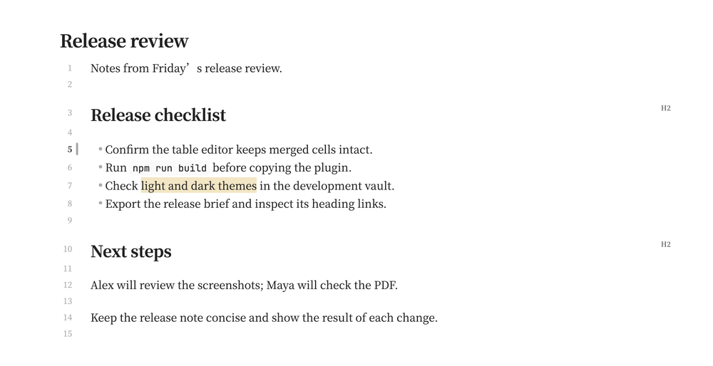
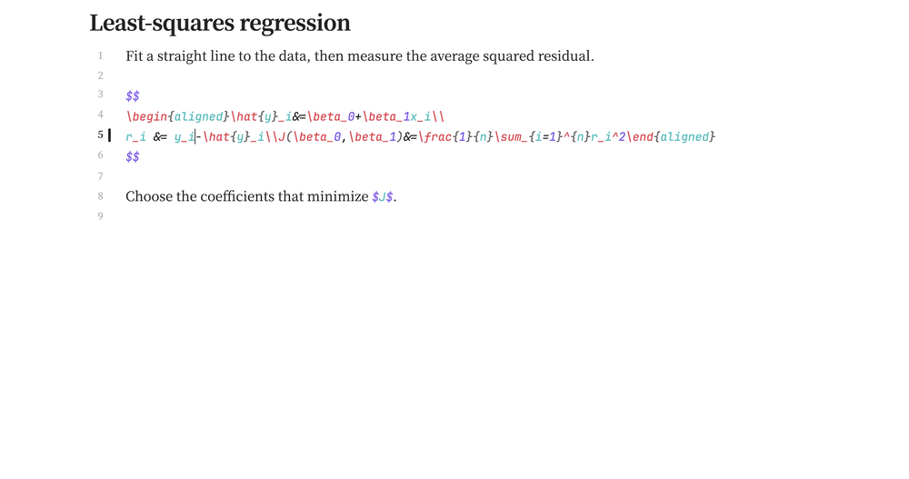
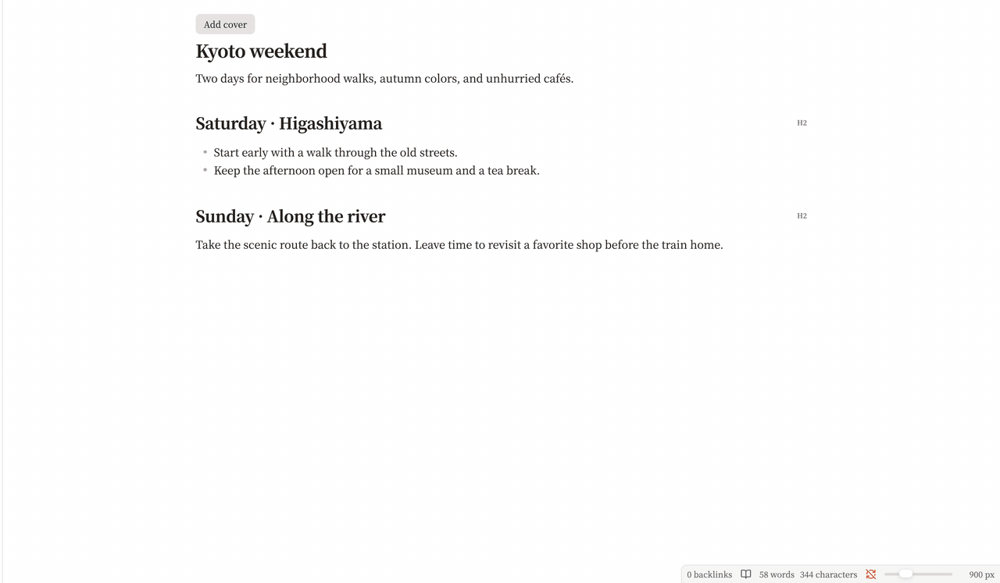
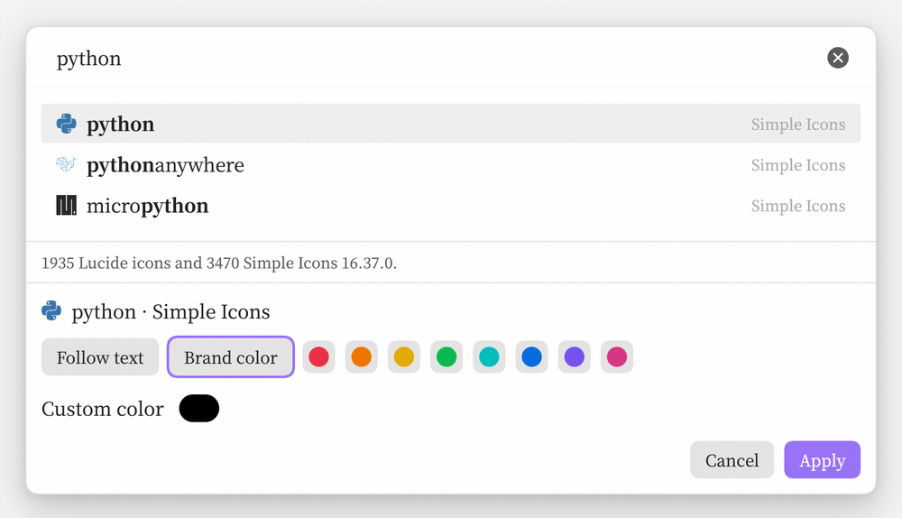
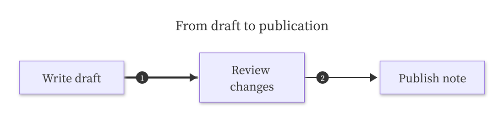
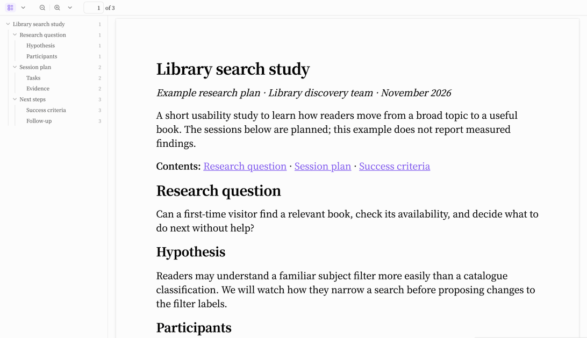

<div align="center">

# Patches — Full

Focused fixes and enhancements for Obsidian

[](https://obsidian.md/) [](https://github.com/yaroxy/obsidian-patch/actions/workflows/build.yml) [](LICENSE)

**[Install](#installation) · [Features](#features) · [Development](#development) · [Changelog](CHANGELOG.md)**

</div>

This is the independent **Full** source branch, `codex/full`, with optional Latest and Custom Mermaid loading. Community Directory source and standard release assets come from [`main`](https://github.com/yaroxy/obsidian-patch/tree/main).

## Features

Full 0.5.0 adds the whole-note diagram check, per-note cover widths, and GitHub folder completion. [Full changelog](CHANGELOG.md)

Find each settings group under **Settings → Patches**.

<table>
<thead><tr><th>Settings group</th><th>Feature</th><th>What you can do</th></tr></thead>
<tbody>
<tr><th rowspan="2" scope="rowgroup">Callouts</th><td><a href="#callout-editor">Callout editor</a></td><td>Edit, convert, and check GitHub compatibility.</td></tr>
<tr><td><a href="#callout-code">Code backgrounds</a></td><td>Tint code to match the surrounding callout.</td></tr>
</tbody>
<tbody>
<tr><th rowspan="2" scope="rowgroup">Editor</th><td><a href="#active-line">Active line</a></td><td>Mark the cursor line and its line number.</td></tr>
<tr><td><a href="#heading-levels">Heading levels</a></td><td>Show heading levels in the margin.</td></tr>
</tbody>
<tbody>
<tr><th scope="row">Line Width</th><td><a href="#line-width">Readable columns</a></td><td>Set a maximum globally or for one note.</td></tr>
</tbody>
<tbody>
<tr><th scope="row">Math Format</th><td><a href="#math-format">Display math</a></td><td>Indent and align formulas.</td></tr>
</tbody>
<tbody>
<tr><th scope="row">Patch Banner</th><td><a href="#patch-banner">Note covers</a></td><td>Add vault media and set the cover width per note.</td></tr>
</tbody>
<tbody>
<tr><th scope="row">Patch Icons</th><td><a href="#patch-icons">File and folder icons</a></td><td>Choose explorer icons and their colors.</td></tr>
</tbody>
<tbody>
<tr><th scope="row">Patch Mermaid</th><td><a href="#patch-mermaid">Diagrams</a></td><td>Render and check diagrams with the selected engine.</td></tr>
</tbody>
<tbody>
<tr><th scope="row">PDF Export</th><td><a href="#pdf-export">PDF navigation</a></td><td>Add heading bookmarks and same-note heading links.</td></tr>
</tbody>
<tbody>
<tr><th scope="row">No settings required</th><td><a href="#html-tables">HTML tables</a></td><td>Edit merged cells and convert Markdown tables.</td></tr>
</tbody>
</table>

## Installation

Requires Obsidian **1.15.0 or later** and Node.js **22 or later** to build. Full is installed from this branch's source; standard GitHub release assets contain Community.

```sh
git clone --branch codex/full --single-branch https://github.com/yaroxy/obsidian-patch.git obsidian-patch-full
cd obsidian-patch-full
npm ci
npm run build
npm run check:release
```

For a new installation, copy `main.js`, `manifest.json`, and `styles.css` from `dist/full/` into `<vault>/.obsidian/plugins/patches/`, reload Obsidian, and enable **Patches** under **Settings → Community plugins**. To update an existing Patches installation, replace those three files and keep `data.json`.

**Upgrading from Obsidian Patch?** Follow the [migration instructions](docs/releases.md#migrating-from-obsidian-patch) before creating a `patches` directory to preserve settings and command hotkeys. Existing `patch-mermaid` blocks and `patch-*` note properties keep working.

| Distribution | Source | Mermaid versions |
| --- | --- | --- |
| Full | This branch, `codex/full`; `npm run build` → `dist/full/` | Bundled, Latest, or Custom; remote versions load from jsDelivr |
| Community | [`main`](https://github.com/yaroxy/obsidian-patch/tree/main) and standard GitHub release assets | Bundled only; no remote Mermaid or ELK code loader |

Both distributions use the same plugin ID and settings, so installing one replaces the other. A Community Directory update replaces a manually installed Full build with Community. To keep using Full, rebuild and install this branch when updating. See [Patch Mermaid](#patch-mermaid) for remote-loading details.

## Active Line

A margin bar marks the cursor's line in Live Preview and Source mode, with a highlighted line number when line numbers are shown. It follows the caret color and fades in unfocused panes. Toggle **Editor → Active line** in the plugin settings; it is on by default.



## Callout Code

Inline code and code-block backgrounds take their callout's color in Reading View and Live Preview, including nested callouts. Syntax highlighting keeps the theme's colors, and title inline code follows the title text. Toggle **Callouts → Code background**; it is on by default.


## Callout Editor

Edit a callout's type, title, fold state, metadata, and content with a live preview.


- **Edit:** hover a callout in Reading View or Live Preview and click **Edit callout**.
- **Insert:** run **Patches: Insert callout** to add one at the cursor or wrap selected lines.
- **Unwrap:** choose **Convert to text** or **Convert to blockquote** in the editor.

The command palette and editor context menu also offer editing and conversion when the cursor is in the callout's source. Header-only edits preserve the body, and saving checks for conflicting changes.

**Make GitHub-compatible** maps the type to a supported alert, moves the title into the content, and removes the fold sign and metadata:

```markdown
> [!warning|wide]- Before the morning train
> Download the tickets for offline access.
```

becomes:

```markdown
> [!WARNING]
> **Before the morning train**
> Download the tickets for offline access.
```

The GitHub panel explains remaining differences, including Obsidian-only syntax. Nested callouts must be moved to the top level manually. Set `github: true` on a note or choose **Callouts → GitHub folders** to enable the status bar count; click it or run **Check callouts for GitHub** for details.

In Full 0.5.0, start typing a folder and choose a suggestion to replace the path under the cursor. The report checks unsaved edits in the editor and the saved note in Reading view. Use **Details** to see the reasons for one callout or **Jump** to go to its line. [Folder demo](docs/images/callout-folder-completion.gif) · [Report screenshot](docs/images/callout-github-report.png)

## Heading Levels

H1–H6 labels appear beside headings in Reading View, Live Preview, and Source mode. Wrapped headings leave room for the label, and Setext headings are supported. Toggle **Editor → Heading levels**; it is on by default. Labels do not change note source or appear in exported PDFs.


## HTML Tables

Create tables with merged cells, grouped headers, and captions through a visual editor.

- **New table:** run **Patches: Insert HTML table**.
- **Existing HTML table:** hover it and choose **Edit table**, or run **Edit HTML table** with the cursor in its source.
- **Markdown table:** place the cursor inside it, then run **Convert Markdown tables to HTML** from the command palette or editor context menu.

Try converting this table:

```markdown
| Day      | Plan                      | Area        |
| :------- | :------------------------ | :---------- |
| Saturday | Walk the canal and sketch | Higashiyama |
| Saturday | Tea break and bookshop    | Gion        |
| Sunday   | Morning market and lunch  | Downtown    |
| Sunday   | Riverside walk            | Kamogawa    |
```

Review the preview, drag across cells or Shift-click to select a range, then use **Merge cells**, **Split cell**, the row and column menus, or alignment controls. Edit the caption above the table. Choose **Convert to HTML** to apply the result; **Cancel** leaves the note unchanged.


Select several complete Markdown tables to convert them together. **Previous table** and **Next table** switch between drafts; **Convert all N tables** writes the batch in one undo step. Conversion preserves headers, alignment, common inline formatting, and links. Tables in code blocks, lists, or callouts are excluded; formulas, images, embeds, footnotes, and excess cells are rejected before anything is written.

In the editor, Tab moves between cells, Enter adds a line within a cell, and Escape leaves the cell. Pasting inserts plain text with its line breaks; Mod+Z and Mod+Shift+Z undo and redo edits. **Save** or Mod+Enter applies HTML-table edits. Untouched cell markup is preserved, and conflicting source changes prevent saving. Tables inside callouts and blockquotes are not detected for editing.

Both table and callout editors resize from their bottom-right corner and remember the size. Double-click the corner to reset.

## Line Width

Adjust the reading column in Reading View, Live Preview, and Source mode. Enable Obsidian's **Settings → Editor → Readable line length**, then use **Line Width** in the plugin settings or the desktop status bar slider. Type an exact whole-number width in settings, then press Enter or leave the field to apply it; the numeric input and slider stay in sync. Both sliders use 1 px steps. The default is **900 px**, with a range of **500–2000 px**; use the settings reset button or click the status bar value to reset it.


The setting is an upper limit. A 1306 px pane with 32 px of padding on each side has room for about 1242 px of text.

Override the width for one note:

```yaml
---
patch-line-width: 1200
---
```

A quoted value such as `"1200px"` also works. Each pane uses its note's width. The status bar disables the slider for a note with an override; an invalid value is ignored and shown in red, with a tooltip explaining the range.

## Math Format

Run **Patches: Format math block** with the cursor inside a `$$` block, or **Format all math blocks in note**.

**Before**

```latex
$$
\begin{aligned}\hat{y}_i&=\beta_0+\beta_1x_i\\
r_i &= y_i-\hat{y}_i\\J(\beta_0,\beta_1)&=\frac{1}{n}\sum_{i=1}^{n}r_i^2\end{aligned}
$$
```

**After**

```latex
$$
\begin{aligned}
  \hat{y}_i          &=\beta_0+\beta_1x_i \\
  r_i                &= y_i-\hat{y}_i \\
  J(\beta_0,\beta_1) &=\frac{1}{n}\sum_{i=1}^{n}r_i^2
\end{aligned}
$$
```

The formatter changes whitespace while preserving formulas. It indents environments and aligns rows in `aligned`, `align`, `alignat`, `split`, `cases`, matrices, `array`, and `gathered`. Callout and list markers are preserved; unsupported or malformed blocks are left unchanged.



Under **Math Format**, choose 2 or 4 spaces of indentation and whether to align `&` and row endings. To format on lint, add **Format all math blocks in note** to Linter's custom commands.

## Patch Banner

Run **Patches: Select cover**, or add a quoted link to an image or video in your vault:

```yaml
---
patch-banner: "[[assets/kyoto-cover.jpg]]"
---
```

The cover picker lists vault file paths locally to find images and videos. These paths are not sent to a remote service.

Covers appear above the title and Properties in Reading View and Live Preview, at their original aspect ratio. Hover to add, change, or remove a cover; removing it clears only the property, keeping the media file.



Save the [Kyoto cover illustration](docs/images/kyoto-cover.jpg) to `assets/kyoto-cover.jpg` in your vault to try this example.

Under **Patch Banner**, adjust **Cover width (%)** from 10–100% of the pane, with a default of 90%, and toggle **Autoplay videos**. Videos are muted, loop, and pause when hidden. Reduced-motion preferences defer playback and animated images until you choose to show them.

With Full 0.5.0, set `patch-banner-width: 65` to center one note’s cover at 65% of its pane. Omitted or invalid values use the vault setting. Image Converter can resize and align a body image that uses the same attachment independently.

Local images and videos are supported where the platform can decode them. Covers do not appear in Source mode, embedded notes, hover previews, Canvas, or PDF exports. Updating the property uses Obsidian's YAML serializer, which may reformat frontmatter and remove comments.

## Patch Icons

Right-click files or folders in the explorer and choose **Change icon** to pick a [Lucide](https://lucide.dev/) icon or [Simple Icons](https://simpleicons.org/) brand logo. Preview the icon and color together, then choose **Apply**. Colors include **Follow text**, **Brand color** when available, eight theme-aware presets, and a custom color. Existing icons keep their appearance; new brand selections use their brand color when available. **Cancel** discards the selection. **Remove icon** clears the icon and its color; both actions support multiple selections. For a selection with different icons, choosing only a color keeps each existing icon.



For files with different colors, **Keep colors** preserves each one while changing icons. Search results scroll while the color controls and Apply/Cancel remain visible; Enter selects an icon from search or activates the focused footer button.

The picker downloads the latest Simple Icons graphic data from jsDelivr on first use in a session, plus brand-color JSON from the corresponding upstream Simple Icons version. These are image and color data, not executable modules. Icons and brand colors already in use are saved locally and display offline; **Patch Icons → Update** refreshes the pack. If color metadata is unavailable, cached brand colors remain usable and other icons can still use text, preset, or custom colors. Simple Icons provides single-color brand marks, so **Brand color** does not recreate multicolor logos. Icons and colors follow renames and moves made inside Obsidian; changes made outside it leave the old assignment behind.

**Import from Iconize** copies supported file and folder icons, replacing existing assignments for those paths. Emoji and other packs are skipped. After importing, disable Iconize to avoid showing two icons for one file. **Icons of missing files** lists the full paths in Full 0.5.0. **Remove** rechecks them so a restored file keeps its icon and color. Icons appear only in the file explorer.

## Patch Mermaid

Use newer Mermaid diagram types and syntax without waiting for Obsidian to update its renderer. Write a `patch-mermaid` code block. This Full distribution offers the bundled Mermaid version plus optional Latest and Custom versions.

Full 0.5.0 adds **Patches: Check diagrams in this note**. It checks every `patch-mermaid` fence with the engine actually in use, including a bundled fallback, and shows its version. Use **Details** for the parser message and **Jump** for the source location. In the editor, checks include unsaved changes.

Bundled Mermaid 12.3.0 can number a flowchart’s arrows and play them in sequence. In this example, the dot follows the draft through review and publication. The badges stay visible between steps. Keep `layout: dagre` to display both badges. [Mermaid flowchart steps](https://mermaid.js.org/syntax/flowchart.html#step-by-step-flow-animation-v12-3-0)



````markdown
```patch-mermaid
---
title: From draft to publication
config:
  layout: dagre
  flowchart:
    stepNumbers: true
    stepDuration: 1.5
    rankSpacing: 110
---
flowchart LR
  A[Write draft] review@--> B[Review changes]
  B publish@--> C[Publish note]
  review@{ step: 1 }
  publish@{ step: 2 }
```
````

Each arrow plays for 1.5 seconds with **Bundled** and the default **Strict** security level. With **Custom** set to Mermaid 12.1.0, the same diagram displays static arrows. [Watch the three-second loop](docs/images/mermaid-flow-steps.gif)

Diagrams follow Obsidian's theme and Mermaid font. Leave `theme` unset in diagram configuration to follow light and dark mode automatically. Standard `mermaid` blocks use Obsidian’s renderer. [Light and dark theme example](docs/images/mermaid-theme.gif)

| Setting         | Choices                                                                                                                                                                       |
| --------------- | ----------------------------------------------------------------------------------------------------------------------------------------------------------------------------- |
| Mermaid version | Choose **Bundled** (default), **Latest**, or **Custom** (an exact version from 11.0.0 onward). Failed remote loads fall back to Bundled. |
| Security level  | **Strict** (default) restricts diagram content and currently hides treeView icons. **Loose** allows additional content and interactions; use it only with diagrams you fully trust. Both modes sanitize the generated SVG before display. |

Some bundled icons, including `material-icon-theme:folder-css` and `logos:chrome-web-store`, currently render incompletely because of Mermaid's own icon filtering, even in Loose mode.

Latest and Custom load Mermaid and ELK code from jsDelivr without an integrity check and run it with full access to Obsidian. Bundled uses the code shipped with the plugin. Full is a separate source distribution and is not submitted to the Community Directory. Simple Icons may download icon data as described above.

Show the plugin's project structure with [treeView](https://mermaid.js.org/syntax/treeView.html). With **Bundled** selected, switch to **Loose** for this trusted example to display icons from the included `material-icon-theme` and `logos` packs:

````markdown
```patch-mermaid
treeView-beta
    obsidian-patch/ icon(material-icon-theme:folder-project)
        src/ icon(material-icon-theme:folder-src)
            features/ icon(material-icon-theme:folder-plugin)
            main.ts icon(material-icon-theme:typescript)
        manifest.json icon(material-icon-theme:json)
        styles.css icon(material-icon-theme:css)
        package.json icon(logos:nodejs-icon)
```
````

## PDF Export

Use Obsidian's **Export to PDF** on desktop. Under **PDF Export**, **Document outline** adds heading bookmarks and **Heading links** enables jumps within the note; both are on by default.



Open the [example research plan](docs/examples/library-search-study.pdf) to try the bookmarks and heading links in your PDF reader.

Links such as `[[#Session plan]]` and `[Success criteria](#success-criteria)` work, including Unicode headings and common Markdown fragments such as `#session-plan-1` for repeated headings. Wikilinks follow Obsidian's native heading matching. Links to other notes, block references, and embedded-note links retain native export behavior.

Export uses the native dialog's paper size, margins, orientation, and title options.

## Customization

<details>
<summary>Appearance tweaks with CSS snippets</summary>

Add any of these overrides to an Obsidian CSS snippet:

```css
body {
  --font-mermaid: "Inter", sans-serif;
  --obsidian-patch-active-line-color: var(--color-accent);
  --obsidian-patch-callout-code-tint: 8%;
  --obsidian-patch-icon-size: 16px;
  --obsidian-patch-icon-gap: 4px;
  --obsidian-patch-icon-offset: -0.2em;
  --obsidian-patch-icon-color: var(--text-accent);
}
```

</details>

## Development

Use Node.js **22 or later**, check out `codex/full`, and run `npm ci`.

```sh
npm run dev          # watch dist/full/
npm test             # unit tests
npm run build        # type-check and build dist/full/
npm run check:release
```

`dev:full` and `build:full` remain aliases for the default commands. Copy the three installation files from `dist/full/` into `<vault>/.obsidian/plugins/patches/` and reload Obsidian after rebuilding.

You can also pin a different bundled Mermaid version in a personal checkout. Test it with representative diagrams before installing. [Personal build instructions](docs/releases.md#choose-a-bundled-mermaid-version)

See [AGENTS.md](AGENTS.md) for development conventions and feature design references, and [Full builds and migration](docs/releases.md) for distribution checks and migration. [Integration testing](docs/integration-testing.md) covers commands, prerequisites, and restoration behavior. Integration suites deploy Full into `dev-vault` and modify dedicated test fixtures; the new build and fixtures remain afterwards. This branch's CI tests Full but does not publish GitHub releases or release attestations.

## Acknowledgments

**Line Width** follows the ideas of [Editor Width Slider](https://github.com/MugishoMp/obsidian-editor-width-slider) by MugishoMp (MIT), and **Patch Icons** follows [Iconize](https://github.com/FlorianWoelki/obsidian-iconize) by Florian Woelki (MIT). Their implementations are written for this plugin; the Iconize importer reads its settings format.

Icons come from [Lucide](https://lucide.dev/) (ISC), [Simple Icons](https://simpleicons.org/) (CC0 1.0), and the [Iconify](https://iconify.design/) packs used by Mermaid. Brand icons are trademarks of their respective owners.

## License

[MIT](LICENSE).
