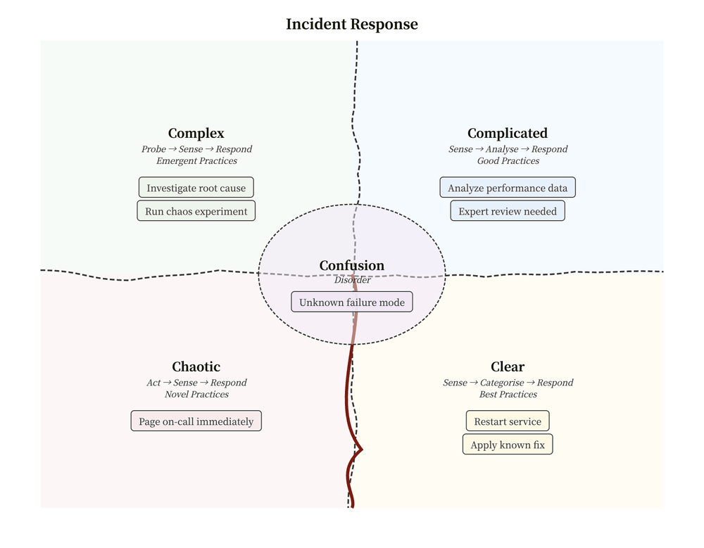
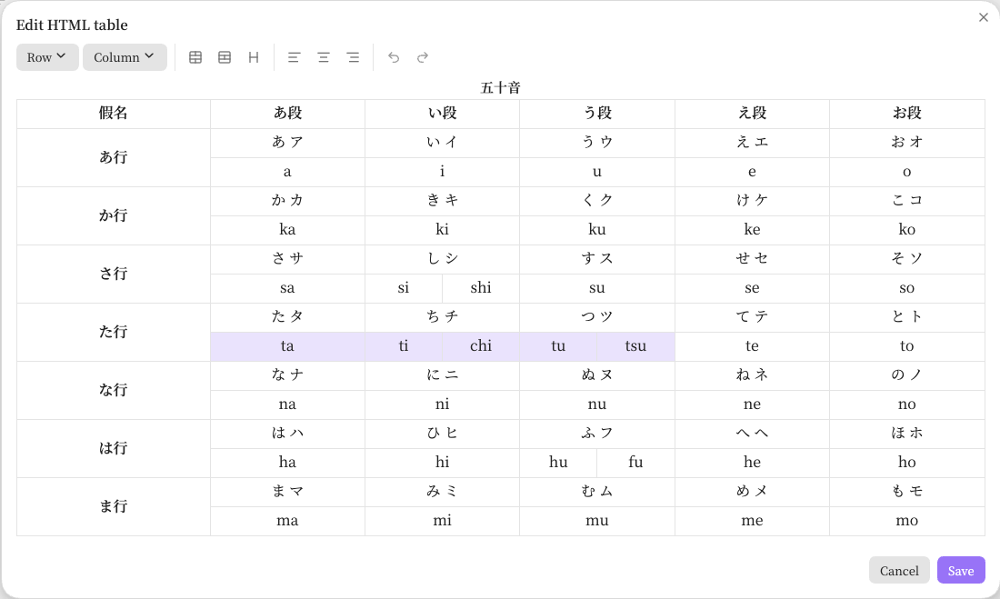
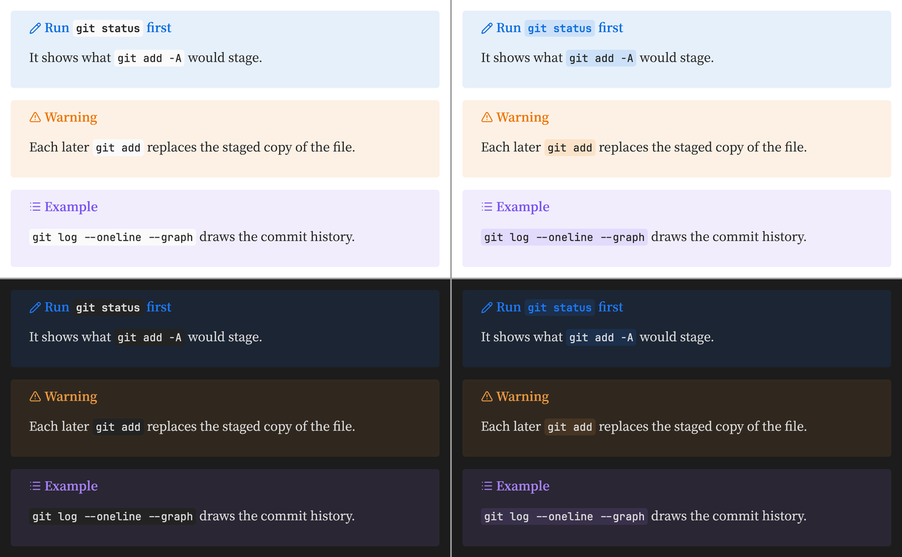
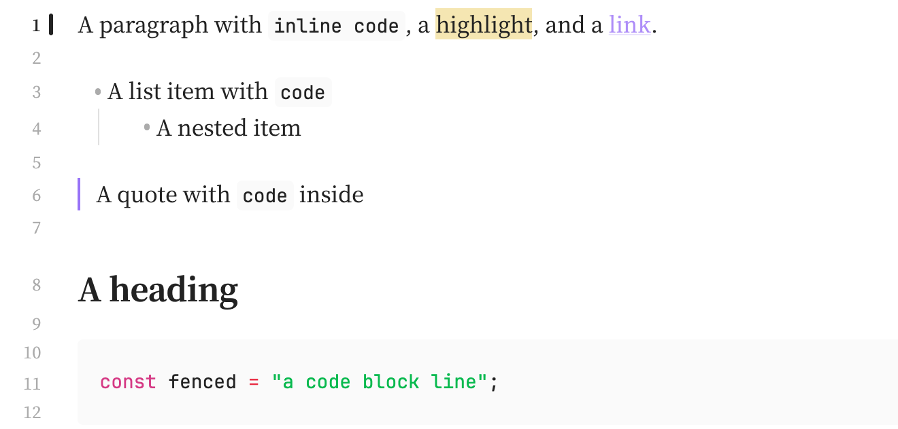

# Obsidian Patch

Obsidian Patch collects focused fixes and enhancements for Obsidian. Each feature is an independent module with its own settings under **Settings > Obsidian Patch**, and changes apply immediately.

| Feature                         | What it does                                                                                        |
| ------------------------------- | --------------------------------------------------------------------------------------------------- |
| [Patch Mermaid](#patch-mermaid) | Renders `patch-mermaid` code blocks with the latest, bundled, or a chosen Mermaid version           |
| [Patch Banner](#patch-banner)   | Shows a vault image, animation, or video as a cover above the note title                            |
| [HTML Tables](#html-tables)     | Inserts and edits HTML tables visually, including merged cells, grouped headers, and captions       |
| [Patch Icons](#patch-icons)     | Puts Lucide and the newest Simple Icons before file and folder names in the file explorer           |
| [Line Width](#line-width)       | Sets the readable line width from a status bar slider, or per note with `patch-line-width`          |
| [Callout Code](#callout-code)   | Tints inline code in callouts with the callout's own color                                          |
| [Active Line](#active-line)     | Marks the line the cursor is on with a bar in the margin                                            |

|                      | Version                                     |
| -------------------- | ------------------------------------------- |
| Plugin               | 0.1.0                                       |
| Tested with Obsidian | 1.14.5 (macOS desktop)                      |
| Minimum Obsidian     | 1.13.7                                      |
| Obsidian API typings | 1.13.1                                      |
| Bundled Mermaid      | 12.1.0, with `@mermaid-js/layout-elk` 1.0.1 |

## Installation

Build with Node.js 22 or later:

```bash
npm install
npm run build
```

Copy `main.js`, `manifest.json`, and `styles.css` to `<vault>/.obsidian/plugins/obsidian-patch/`, reload Obsidian, and enable **Obsidian Patch** under **Settings > Community plugins**.

> [!NOTE]
> Upgrading from an earlier build: the plugin ID changed from `mermaid-patch` to `obsidian-patch`, so move the plugin to the new directory and enable it again. Code blocks are now `patch-mermaid` instead of `mermaid-latest`.

## Patch Mermaid

Write a `patch-mermaid` code block. The built-in `mermaid` block is left alone, so both renderers work side by side.

````markdown
```patch-mermaid
flowchart LR
    A[Obsidian] --> B[Patch Mermaid]
```
````



| Setting         | Options                                                                                                                                                                               |
| --------------- | ------------------------------------------------------------------------------------------------------------------------------------------------------------------------------------- |
| Mermaid version | **Latest** (default) loads the newest release from jsDelivr. **Bundled** uses the copy inside `main.js` and works offline. **Custom** loads an exact release from 11.0.0 on, such as `12.0.0`. |
| Security level  | **Strict** (default) sanitizes the SVG, which currently hides treeView icons. **Loose** inserts Mermaid's output unsanitized.                                                          |

- **Fallback.** A remote version that cannot be loaded falls back to the bundled copy, and the setting shows the version in use and why. Latest remembers the version it last resolved, so offline startups can use the cached copy.
- **Trust.** Remote versions run with full access to Obsidian and come from npm through jsDelivr without an integrity check, because `latest` changes with every release. Choose Bundled to run only code shipped with the plugin.
- **Loose** exposes Obsidian to any HTML or SVG in a diagram. Use it only for diagrams you fully trust, not for copied, imported, synchronized, or generated notes.

Diagrams follow Obsidian's light or dark theme and use the `--font-mermaid` font, like the built-in renderer, re-rendering when either changes. ELK layouts load in the `@mermaid-js/layout-elk` line that matches Mermaid's major version. To give diagrams their own font:

```css
body {
  --font-mermaid: "Inter", sans-serif;
}
```

TreeView icons require Loose and come from two bundled packs, `material-icon-theme` and [SVG Logos](https://icon-sets.iconify.design/logos/) (`logos`, CC0). Set icons per item, or a default pack and file-type mappings in the diagram's frontmatter:

````markdown
```patch-mermaid
treeView-beta
    project/
        src/ icon(material-icon-theme:folder-src)
            index.ts icon(material-icon-theme:typescript)
        package.json icon(logos:nodejs-icon)
```

```patch-mermaid
---
config:
  treeView:
    showIcons: true
    defaultIconPack: material-icon-theme
    filenameIcons:
      package.json: nodejs
    extensionIcons:
      .ts: typescript
---
treeView-beta
    project/
        src/
            index.ts
        package.json
```
````

## Patch Banner

Run **Obsidian Patch: Select cover** to pick an image or video from the vault, or set the property by hand:

```yaml
---
patch-banner: "[[assets/banner.png]]"
---
```

The value must be a quoted wikilink to a vault file. The cover appears above the inline title and Properties in Reading View and Live Preview, uncropped at its original aspect ratio, and scrolls with the note. Hover it for **Change cover** and **Remove cover**, which deletes only the property. A note without a cover offers **Add cover** when you hover above the title.

| Setting         | Default | Notes                                                                                                                              |
| --------------- | ------- | ---------------------------------------------------------------------------------------------------------------------------------- |
| Enabled         | On      |                                                                                                                                    |
| Cover width (%) | 90      | 10–100% of the note pane, centered. The text keeps its readable width. The reset button restores 90%.                               |
| Autoplay videos | On      | Videos are muted, loop, and pause when hidden or off-screen. With reduced motion, videos wait for a click and images that may animate wait for **Show media**. |

Supported formats are JPG, PNG, WebP, GIF, SVG, BMP, AVIF, APNG, MP4, WebM, and MOV, as far as the platform can decode them. Source mode, embedded notes, hover previews, Canvas, and PDF export show no cover. The property is written through Obsidian's frontmatter serializer, which may reformat YAML and drop comments.

## HTML Tables

Markdown tables cannot merge cells, group headers, or carry a caption. HTML tables can, and this feature edits them visually instead of by hand.

- Run **Obsidian Patch: Insert HTML table** to start a 3 × 3 table at the cursor.
- To edit a table, hover it in Reading View or Live Preview and click **Edit table**, or run **Edit HTML table** with the cursor in its source.



Type into any cell or the caption. Drag across cells, or Shift-click, to select a range, then use the toolbar or the right-click menu:

| Action           | How                                                         |
| ---------------- | ----------------------------------------------------------- |
| Merge or split   | **Merge cells**, **Split cell**                             |
| Rows and columns | **Row** and **Column** menus: insert on either side, delete |
| Header cells     | **Toggle header cell**                                      |
| Alignment        | **Align left**, **Align center**, **Align right**           |
| Undo and redo    | Toolbar, or Mod+Z and Mod+Shift+Z                           |
| Save or discard  | **Save** or Mod+Enter; **Cancel**, or Escape outside a cell |

In a cell, Tab moves to the next one and adds a row after the last, Enter starts a new line, and Escape leaves the cell.

The editor writes HTML that looks like a native table in both views. The block has no blank lines, every new cell has an explicit `align`, merged row spans are centered vertically, and the first header row carries the column widths:

```html
<table style="width:100%">
  <caption style="caption-side:top; text-align:center; font-weight:600; padding:0 0 4px">五十音</caption>
  <thead>
    <tr>
      <th align="center" style="width:20%">假名</th>
      <th colspan="2" align="center" style="width:40%">い段</th>
      <th align="center" style="width:40%">う段</th>
    </tr>
  </thead>
  <tbody>
    <tr>
      <th rowspan="2" align="center" style="vertical-align:middle">さ行</th>
      <td colspan="2" align="center">し シ</td>
      <td align="center">す ス</td>
    </tr>
    <tr>
      <td align="center">si</td>
      <td align="center">shi</td>
      <td align="center">su</td>
    </tr>
  </tbody>
</table>
```

Cells you do not edit keep their markup and attributes, and an unchanged table is not written back. If the note changed while the editor was open, saving shows a notice instead of overwriting it. Tables inside callouts and blockquotes are not detected.

## Patch Icons

Right-click a file or folder in the file explorer and choose **Change icon** to pick a [Lucide](https://lucide.dev/) icon, built into Obsidian, or a [Simple Icons](https://simpleicons.org/) brand logo. **Remove icon** clears it, and both work on several selected files at once. An icon takes the color of the name beside it.

| Setting                | Notes                                                                                                                                                       |
| ---------------------- | ----------------------------------------------------------------------------------------------------------------------------------------------------------- |
| Enabled                | On by default.                                                                                                                                              |
| Simple Icons           | The picker downloads the newest release from jsDelivr, as Iconify's `@iconify-json/simple-icons`, the first time it opens in a session. **Update** loads it again and refreshes the icons in use. |
| Import from Iconize    | Copies Iconize's file and folder icons, replacing icons already set for the same paths. Emoji and other icon packs are skipped and listed in the notice. Disable Iconize afterwards so icons are not drawn twice. |
| Icons of missing files | Lists icons whose path no longer exists, and removes them.                                                                                                  |

- **Offline.** The SVG of each Simple Icon in use is saved with the plugin's settings, so icons appear at startup without a download. The picker lists Lucide icons at once and adds Simple Icons when they arrive.
- **Renames.** Icons follow files and folders renamed or moved inside Obsidian, including a folder's contents. A deleted path keeps its icon in case it comes back. A rename made outside Obsidian, for example by sync or a terminal, looks like a deletion and leaves the icon at the old path.
- **Rendering.** A generated stylesheet keyed on the explorer's `data-path` attributes draws each icon as a CSS mask. The explorer's DOM is never modified, and downloaded SVGs are only used as images, so they cannot run code.

Only the file explorer shows icons. Tabs, note titles, emoji, custom icon packs, per-icon colors, and rules are out of scope.

```css
body {
  --obsidian-patch-icon-size: 16px;
  --obsidian-patch-icon-gap: 4px;
  --obsidian-patch-icon-offset: -0.2em; /* vertical alignment with the name */
  --obsidian-patch-icon-color: var(--text-accent); /* default: the name's color */
}
```

## Line Width

Sets Obsidian's readable line width, `--file-line-width`, in Reading View, Live Preview, and Source mode. It needs **Settings > Editor > Readable line length**, which is on by default.

| Setting            | Default | Notes                                                                                                                       |
| ------------------ | ------- | --------------------------------------------------------------------------------------------------------------------------- |
| Enabled            | On      |                                                                                                                             |
| Line width (px)    | 900     | 500–2000 px in 10 px steps, for notes without their own width. Obsidian's own width is 700 px. The reset button restores 900 px. |
| Show in status bar | On      | Drag the slider to resize open notes as you go; the width is saved when you release it. Click the value to reset it. Desktop only. |

A note sets its own width with a whole number of pixels from 500 to 2000, written as `1200` or `"1200px"`:

```yaml
---
patch-line-width: 1200
---
```

The property resizes only the pane that shows the note, so splits can differ, and edits to it apply at once. While such a note is active, the status bar shows its width in the accent color and disables the slider. An invalid value is ignored and shows in red; hover over it for the accepted range.

Coming from Editor Width Slider: its slider value N is 700 + 10 × N px here, so its default of 20 is the same 900 px. Its `editor-width` property used another scale and is not read.

## Callout Code

A toggle under **Callouts**, on by default. Obsidian paints inline code on an opaque gray chip meant for the page background, so inside a callout's tint the chip reads as a hole. With the toggle on, inline code in a callout is tinted with that callout's own color in Reading View and Live Preview, nested callouts use their own color, and code in a callout title takes the title's color. Fenced code blocks keep the theme's colors.



The chip mixes 12% of the callout color over the callout's own 10% tint. Change the strength from a CSS snippet:

```css
body {
  --obsidian-patch-callout-code-tint: 8%;
}
```

## Active Line

A toggle under **Editor**, on by default. A bar in the margin marks the cursor's line in Live Preview and Source mode, and its line number is highlighted when line numbers are shown. The bar paints nothing under the line, so inline code, highlights, and code blocks keep their own backgrounds. It takes the caret's color rather than the accent, which quote lines already use for their border, and fades in unfocused splits, so each split still shows its cursor's line while the focused one stands out.



```css
body {
  --obsidian-patch-active-line-color: var(--color-accent);
}
```

## Development

```bash
npm run dev     # rebuild main.js on every change
npm test        # unit tests
npm run build   # type-check, then build main.js
```

The integration suites run inside Obsidian through the Obsidian CLI. Point them at a development vault: each run installs the current build into its `obsidian-patch` plugin directory and overwrites its test notes. Keep the Obsidian window visible, because a hidden window receives no animation frames or observer callbacks.

```bash
node scripts/test-banner.mjs /path/to/dev-vault   # needs banner.png in the vault root, ffmpeg, and gif2webp
node scripts/test-table.mjs /path/to/dev-vault
```

```text
.
├── .github/                       Dependabot and the build workflow
├── docs/                          Design notes, verification records, README images
├── scripts/                       Obsidian integration suites
├── src/
│   ├── features/                  One independent module per feature
│   │   ├── active-line.ts
│   │   ├── banner.ts, banner/     Cover properties, media, mounting, and picker
│   │   ├── callout-code.ts
│   │   ├── icons.ts, icons/       Explorer icons, picker, Simple Icons loading, Iconize import
│   │   ├── line-width.ts, line-width/ Per-pane width, status bar slider, property parsing
│   │   ├── mermaid-runtime.ts     Loads Mermaid from jsDelivr or the bundle
│   │   ├── patch-mermaid.ts       Code block processor, theming, re-rendering
│   │   └── table.ts, table/       Table model, editor, and entry points
│   ├── build.d.ts                 Types for values the build injects
│   └── main.ts                    Plugin entry point and settings tab
├── tests/                         Unit tests
├── esbuild.config.mjs             Bundles src/ into main.js
├── manifest.json, versions.json   Plugin metadata and minimum app versions
└── styles.css                     All plugin styles
```

Add a feature as a focused module under `src/features/` with a small registration function called from `src/main.ts`. CSS classes use the `obsidian-patch-<feature>` prefix, and user-visible changes go under `Unreleased` in [CHANGELOG.md](CHANGELOG.md). Design notes: [Patch Banner](docs/banner-design.md) and its [verification record](docs/banner-testing.md), [HTML Tables](docs/table-design.md).

## Changelog

See [CHANGELOG.md](CHANGELOG.md).

## References

- [Mermaid documentation](https://mermaid.js.org/)
- [Mermaid releases](https://github.com/mermaid-js/mermaid/releases)
- [ELK layout for Mermaid](https://github.com/mermaid-js/mermaid/tree/develop/packages/mermaid-layout-elk)
- [jsDelivr](https://www.jsdelivr.com/package/npm/mermaid) and its [data API](https://github.com/jsdelivr/data.jsdelivr.com)
- [Iconify icon sets](https://icon-sets.iconify.design/) and the [`@iconify-json/simple-icons`](https://www.npmjs.com/package/@iconify-json/simple-icons) package
- [Simple Icons](https://simpleicons.org/) and [Lucide](https://lucide.dev/)
- [Obsidian developer documentation](https://docs.obsidian.md/)
- [Nord color palette](https://www.nordtheme.com/docs/colors-and-palettes)
- [Keep a Changelog](https://keepachangelog.com/en/1.1.0/)

## Acknowledgments

Two features build on the ideas of other community plugins. Their code is written for this plugin; the importer reproduces Iconize's icon naming so it can read Iconize's settings.

- **Line Width** follows [Editor Width Slider](https://github.com/MugishoMp/obsidian-editor-width-slider) by MugishoMp (MIT): a status bar slider for the line width and a per-note width property.
- **Patch Icons** follows [Iconize](https://github.com/FlorianWoelki/obsidian-iconize) by Florian Woelki (MIT): file and folder icons in the explorer, chosen from Lucide and Simple Icons in a searchable picker.

Icons come from [Lucide](https://lucide.dev/) (ISC), which ships with Obsidian, and [Simple Icons](https://simpleicons.org/) (CC0 1.0), packaged by [Iconify](https://iconify.design/). Brand icons are trademarks of their respective owners.

## Contributors

- yaroxy (yaroxywithyou@gmail.com)
- GPT
- Claude

## License

Released under the [MIT License](LICENSE).
