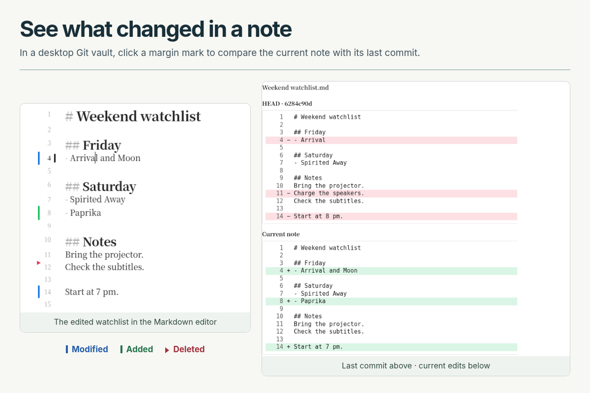

<div align="center">

# Patches

Focused fixes and enhancements for Obsidian.

Edit tables and callouts, shape your reading space, and make diagrams and exported PDFs more useful.

[](https://obsidian.md/) [](https://github.com/yaroxy/obsidian-patch/actions/workflows/build.yml) [](LICENSE)

**[Install](#installation) · [Website](https://yaroxy.github.io/obsidian-patch/) · [User guide](https://yaroxy.github.io/obsidian-patch/getting-started.html) · [Changelog](CHANGELOG.md) · [Report an issue](https://github.com/yaroxy/obsidian-patch/issues)**

</div>


One note, a few improvements: a [vault-image banner](https://yaroxy.github.io/obsidian-patch/features/banner.html), a [grouped itinerary](https://yaroxy.github.io/obsidian-patch/features/tables.html), and [code that fits its callout](https://yaroxy.github.io/obsidian-patch/features/callouts.html).

## New in 0.8.0

Patches 0.8.0 adds display-only section numbers. Add `patch-heading-numbering: decimal` to a note’s properties and headings such as **Methods** and its subsection **Materials** appear as **1 Methods** and **1.1 Materials** in Live Preview and Reading View. Move a section and its numbers update automatically. Heading links, copied text and the Markdown file keep the original titles. Vault-wide numbering starts off. [Try a sample note and compare the four styles](https://yaroxy.github.io/obsidian-patch/features/heading-levels.html#heading-numbering)


Consecutive Git edits now share a margin bar. On desktop, Line Width keeps 500 px between the sidebars as the window narrows. Diagrams that use Logos or Material Icon Theme icons need the corresponding pack installed once from Patch Mermaid settings. [0.8.0 release notes and downloads](https://github.com/yaroxy/obsidian-patch/releases/tag/0.8.0)

## New in 0.7.0

- Desktop vaults inside a Git working tree automatically show change markers in visible Markdown editors. Click a marker or run **View Git diff for this note** to compare the last commit with your current edits. **Toggle Git change markers for this vault** controls the gutter across the vault. [Git diff guide](https://yaroxy.github.io/obsidian-patch/reference/commands.html#compare-a-note-with-git)
- Install the shared **Simple Icons** catalog through **Patch Icons → Simple Icons → Install** to choose brand logos offline for callouts, files and folders. The wider Callout appearance panel includes color swatches and uses the Obsidian interface font for type suggestions. [Callout appearance](https://yaroxy.github.io/obsidian-patch/features/callouts.html#type-appearance)
- The HTML table code font field suggests installed families on supported devices. [Inline code font](https://yaroxy.github.io/obsidian-patch/features/tables.html#inline-code-font)



## Features

Find appearance and editing options under **Settings → Patches**, and Git commands in the desktop command palette.

- **Callouts**
  - [Edit, preview, and unwrap callouts](https://yaroxy.github.io/obsidian-patch/features/callouts.html). Set icons and colors by type, tint code backgrounds, and [check folders for GitHub compatibility](https://yaroxy.github.io/obsidian-patch/features/callouts.html#github-folders).
- **Editor**
  - [Active line](https://yaroxy.github.io/obsidian-patch/features/active-line.html) marks the current line in the margin and highlights its line number. In a Git vault, consecutive additions or edits form a continuous colored bar beside it.
  - [Show H1–H6 labels](https://yaroxy.github.io/obsidian-patch/features/heading-levels.html) beside the first line of each heading. Live Preview shares the extra heading space evenly above and below the text.
- **Git on desktop**
  - [Compare edits with the last commit](https://yaroxy.github.io/obsidian-patch/reference/commands.html#compare-a-note-with-git), including unsaved text. Click a margin marker to open that change.
- **HTML Tables**
  - [Convert between Markdown and HTML tables](https://yaroxy.github.io/obsidian-patch/features/tables.html). Edit merged cells and captions, and choose a font for inline code in HTML cells.
- **Line Width**
  - [Adjust the reading column](https://yaroxy.github.io/obsidian-patch/features/line-width.html) globally or for a single note. In 0.8.0, Line Width also keeps at least 500 px between the sidebars when resizing the desktop window.
- **Math Format**
  - [Indent and align display formulas](https://yaroxy.github.io/obsidian-patch/features/math-format.html).
- **Patch Banner**
  - [Add a note cover](https://yaroxy.github.io/obsidian-patch/features/banner.html) using an image, animation, or video from the vault. Set its width per note.
- **Patch Icons**
  - [Customize file and folder icons](https://yaroxy.github.io/obsidian-patch/features/icons.html) with Lucide icons, brand marks, and colors.
- **Patch Mermaid**
  - [Number and animate flowchart steps](https://yaroxy.github.io/obsidian-patch/features/mermaid.html#number-the-steps-in-a-flowchart). Check every diagram in a note and jump to syntax errors.
- **PDF Export**
  - [Add PDF navigation](https://yaroxy.github.io/obsidian-patch/features/pdf-export.html) with bookmarks and links to headings in the same note on desktop.

## Installation

Requires **Obsidian 1.15.0 or later**. [Patches is available in the Community Directory](https://community.obsidian.md/plugins/patches).

1. Open **Settings → Community plugins → Browse**.
2. Search for **Patches**, then select **Install** and **Enable**.
3. Open **Settings → Patches** to choose your settings.

With Obsidian Sync Standard, install Patches on each device. Its bundled diagram renderer makes `main.js` larger than the plan’s 5 MB per-file limit.

In 0.8.0, diagrams using `logos:` or `material-icon-theme:` icons need a download under **Settings → Patches → Patch Mermaid → Install** once per pack version. Version 0.7.0 includes both packs.

For manual installation, download `main.js`, `manifest.json`, and `styles.css` from the [latest release](https://github.com/yaroxy/obsidian-patch/releases/latest). Put them in `<vault>/.obsidian/plugins/patches/`, reload Obsidian, and enable Patches.

Official releases contain the **Community** build with bundled Mermaid. To bundle a different version yourself, see [Choose a Mermaid version](#choose-a-mermaid-version). The optional [Full branch](https://github.com/yaroxy/obsidian-patch/tree/codex/full) adds remote Mermaid versions for manual source builds. Both use the same plugin ID; installing one replaces the other.

## Try it

Enable Obsidian’s **Settings → Editor → Readable line length**, then give one note a wider column:

```yaml
---
patch-line-width: 1100
---
```

Other notes keep their global width. See [note properties](https://yaroxy.github.io/obsidian-patch/reference/properties.html), [commands](https://yaroxy.github.io/obsidian-patch/reference/commands.html), and [views and platforms](https://yaroxy.github.io/obsidian-patch/reference/compatibility.html) for more examples and scope.

## Network and privacy

The Community build runs its bundled Mermaid code locally. Patches 0.8.0 downloads version-pinned diagram icon JSON from **jsDelivr** when you install a pack or repair a damaged copy. Installed packs load locally. In 0.7.0, selecting **Install** or **Update** for Simple Icons downloads the catalog and brand-color JSON from the same service. Opening the picker and searching installed icons work offline. Search terms, note contents and file names stay on the device. On desktop, Patches checks the vault and its parent directories for Git metadata to find the working tree. To compare a note with its last commit, it reads the local repository’s Git objects, which can reside outside the vault.

The optional Full build can download and execute Mermaid/ELK JavaScript from jsDelivr when Latest or Custom is selected, with access to Obsidian. The cover picker lists vault media locally, and Iconize import reads settings within the vault. Patches has no analytics or telemetry. See [network and privacy](https://yaroxy.github.io/obsidian-patch/privacy.html) for details.

## Help

For questions or examples from your own notes, join the [Patches forum discussion](https://forum.obsidian.md/t/patches-focused-fixes-and-enhancements-for-everyday-obsidian-use/121923). For a reproducible problem, include your Obsidian and Patches versions, OS, theme, view mode, steps, and a small example or recording. [Troubleshooting](https://yaroxy.github.io/obsidian-patch/troubleshooting.html) · [Report a bug](https://github.com/yaroxy/obsidian-patch/issues)

## Development

Use Node.js **22 or later**:

```bash
npm ci
npm test
npm run build       # community plugin → dist/community/
npm run docs:dev    # local documentation preview
npm run docs:build  # static site → site/.vitepress/dist/
```

Install the three plugin files from `dist/community/` into the vault’s `patches` directory and reload the plugin. Integration checks deploy to `dev-vault` and create temporary fixtures; read [integration testing](docs/integration-testing.md) first.

See [AGENTS.md](AGENTS.md) for feature design references, [release documentation](docs/releases.md) for the plugin workflow, and [documentation maintenance](docs/site-design.md) for the website.

Design research covers an independent PDF preview tab and incremental bilingual translation. The PDF experiment is awaiting scope review, and translation implementation is deferred. [PDF pagination research](docs/pdf-pagination-prototype.md#独立标签页-pdf-预览调研2026-11-18) · [Incremental translation research](docs/code-block-lint-and-bilingual-translation.md#incremental-translation-research)

### Choose a Mermaid version

In a separate checkout of the Patches release you want to build, replace `12.1.0` below with your chosen exact version. The install saves it in that checkout’s package and lockfile.

```sh
npm install --save-exact mermaid@12.1.0
npm test
npm run build
npm run check:release
```

Official release testing covers the pinned version. Other versions can change diagram syntax, layout, or ELK compatibility. Before using the build in your own notes, run `node scripts/test-mermaid.mjs /absolute/path/to/dev-vault` in a [prepared development vault](docs/integration-testing.md) and try your own diagrams. **Settings → Patches → Patch Mermaid** shows the version actually bundled.

## Acknowledgments

**Line Width** follows the ideas of [Editor Width Slider](https://github.com/MugishoMp/obsidian-editor-width-slider) by MugishoMp (MIT), and **Patch Icons** follows [Iconize](https://github.com/FlorianWoelki/obsidian-iconize) by Florian Woelki (MIT). Their implementations are written for this plugin; the Iconize importer reads its settings format.

The desktop note comparison uses [jsdiff](https://github.com/kpdecker/jsdiff) (BSD-3-Clause).

Icons come from [Lucide](https://lucide.dev/) (ISC), [Simple Icons](https://simpleicons.org/) (CC0 1.0), and the [Iconify](https://iconify.design/) packs used by Mermaid. Brand icons are trademarks of their respective owners.

## License

[MIT](LICENSE).
