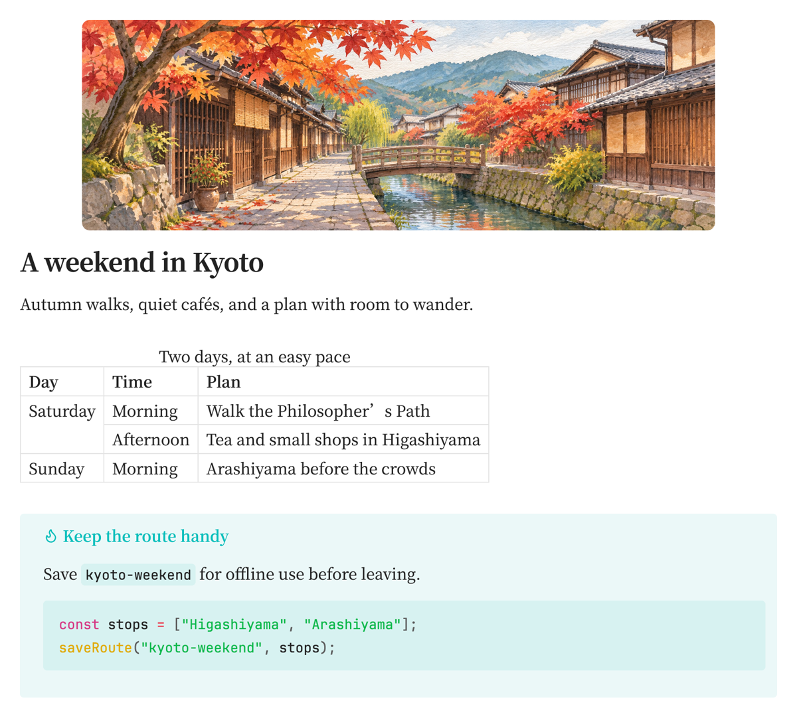

<div align="center">

# Patches

Focused fixes and enhancements for Obsidian.

Edit tables and callouts, shape your reading space, and make diagrams and exported PDFs more useful.

[](https://obsidian.md/) [](https://github.com/yaroxy/obsidian-patch/actions/workflows/build.yml) [](LICENSE)

**[Install](#installation) · [Website](https://yaroxy.github.io/obsidian-patch/) · [User guide](https://yaroxy.github.io/obsidian-patch/getting-started.html) · [Changelog](CHANGELOG.md) · [Report an issue](https://github.com/yaroxy/obsidian-patch/issues)**

</div>



One note, a few improvements: a [vault-image banner](https://yaroxy.github.io/obsidian-patch/features/banner.html), a [grouped itinerary](https://yaroxy.github.io/obsidian-patch/features/tables.html), and [code that fits its callout](https://yaroxy.github.io/obsidian-patch/features/callouts.html).

## New in 0.5.1

Convert Markdown tables to HTML and keep inline LaTeX rendered in Reading View and Live Preview. [See the converted table](docs/images/inline-math-table.png) · [Release notes](https://github.com/yaroxy/obsidian-patch/releases/tag/0.5.1)

## Next release preview

- **Tables.** Convert a standalone HTML table back to Markdown. On desktop, resize the preview to compare wide tables with their Markdown source. Choose an installed font for inline code in HTML table cells.
- **Callouts.** Type `> [!tip` and choose `TIP` to insert `> [!TIP]`. Multiline plain-text pastes keep their quote markers. Give each callout type a Lucide icon and a preset or custom color.

[Full list of unreleased changes](CHANGELOG.md#unreleased)

## Features

These features are available in 0.5.1. Open a feature guide for examples.

<table>
<thead><tr><th>Settings group</th><th>Feature</th><th>What you can do</th></tr></thead>
<tbody>
<tr><th scope="row">Callouts</th><td><a href="https://yaroxy.github.io/obsidian-patch/features/callouts.html">Callout editor</a></td><td>Edit, preview, and unwrap callouts. Match code backgrounds to their callout and check <a href="https://yaroxy.github.io/obsidian-patch/features/callouts.html#github-folders">folders for GitHub</a>.</td></tr>
</tbody>
<tbody>
<tr><th rowspan="2" scope="rowgroup">Editor</th><td><a href="https://yaroxy.github.io/obsidian-patch/features/active-line.html">Active line</a></td><td>Mark the current line in the margin and highlight its line number.</td></tr>
<tr><td><a href="https://yaroxy.github.io/obsidian-patch/features/heading-levels.html">Heading levels</a></td><td>Show H1–H6 labels beside headings in reading and editing views.</td></tr>
</tbody>
<tbody>
<tr><th scope="row">Line Width</th><td><a href="https://yaroxy.github.io/obsidian-patch/features/line-width.html">Readable columns</a></td><td>Set the maximum column width globally or for a single note.</td></tr>
<tr><th scope="row">Math Format</th><td><a href="https://yaroxy.github.io/obsidian-patch/features/math-format.html">Display math</a></td><td>Indent and align formulas.</td></tr>
<tr><th scope="row">Patch Banner</th><td><a href="https://yaroxy.github.io/obsidian-patch/features/banner.html">Note covers</a></td><td>Use a vault image, animation, or video as a cover. Set its width per note.</td></tr>
<tr><th scope="row">Patch Icons</th><td><a href="https://yaroxy.github.io/obsidian-patch/features/icons.html">File and folder icons</a></td><td>Choose Lucide icons or brand marks and set their colors.</td></tr>
<tr><th scope="row">Patch Mermaid</th><td><a href="https://yaroxy.github.io/obsidian-patch/features/mermaid.html#number-the-steps-in-a-flowchart">Diagrams</a></td><td>Number flowchart steps and watch the arrows play in order. Check all diagrams in a note and jump to syntax errors.</td></tr>
<tr><th scope="row">PDF Export</th><td><a href="https://yaroxy.github.io/obsidian-patch/features/pdf-export.html">PDF navigation</a></td><td>Add heading bookmarks and same-note heading links to desktop exports.</td></tr>
<tr><th scope="row">No settings required</th><td><a href="https://yaroxy.github.io/obsidian-patch/features/tables.html">HTML tables</a></td><td>Convert Markdown tables to HTML, then edit merged cells, grouped headers, and captions visually.</td></tr>
</tbody>
</table>

## Installation

Requires **Obsidian 1.15.0 or later**. [Patches is available in the Community Directory](https://community.obsidian.md/plugins/patches).

1. Open **Settings → Community plugins → Browse**.
2. Search for **Patches**, then select **Install** and **Enable**.
3. Open **Settings → Patches** to choose your settings.

With Obsidian Sync Standard, install Patches on each device. Its bundled diagram renderer and icon packs make `main.js` larger than the plan’s 5 MB per-file limit.

For manual installation, download `main.js`, `manifest.json`, and `styles.css` from the [latest release](https://github.com/yaroxy/obsidian-patch/releases/latest). Put them in `<vault>/.obsidian/plugins/patches/`, reload Obsidian, and enable Patches.

Official releases contain the **Community** build with bundled Mermaid. To bundle a different version yourself, see [Choose a Mermaid version](#choose-a-mermaid-version). The optional [Full branch](https://github.com/yaroxy/obsidian-patch/tree/codex/full) adds remote Mermaid versions for manual source builds. Both use the same plugin ID; installing one replaces the other.

## Try it

Enable Obsidian’s **Settings → Editor → Readable line length**, then give one note a wider column:

```yaml
---
patch-line-width: 1100
---
```

Other notes keep their global width. See [note properties](https://yaroxy.github.io/obsidian-patch/reference/properties.html), [commands](https://yaroxy.github.io/obsidian-patch/reference/commands.html), and [views and platforms](https://yaroxy.github.io/obsidian-patch/reference/compatibility.html) for more examples and scope.

## Network and privacy

The Community build runs its bundled Mermaid code locally. The icon picker may contact **jsDelivr** to resolve and download Simple Icons graphic data and matching brand-color JSON. Already-used graphics and available brand colors are cached locally. Missing cached graphics can trigger a download. Icon search text, note contents, and vault file names are not sent in these requests.

The optional Full build can download and execute Mermaid/ELK JavaScript from jsDelivr when Latest or Custom is selected, with access to Obsidian. The cover picker lists vault media locally, and Iconize import reads settings within the vault. Patches has no analytics or telemetry. See [network and privacy](https://yaroxy.github.io/obsidian-patch/privacy.html) for details.

## Help

For questions or examples from your own notes, join the [Patches forum discussion](https://forum.obsidian.md/t/patches-focused-fixes-and-enhancements-for-everyday-obsidian-use/121923). For a reproducible problem, include your Obsidian and Patches versions, OS, theme, view mode, steps, and a small example or recording. [Troubleshooting](https://yaroxy.github.io/obsidian-patch/troubleshooting.html) · [Report a bug](https://github.com/yaroxy/obsidian-patch/issues)

## Development

Use Node.js **22 or later**:

```bash
npm ci
npm test
npm run build       # community plugin → dist/community/
npm run docs:dev    # local documentation preview
npm run docs:build  # static site → site/.vitepress/dist/
```

Install the three plugin files from `dist/community/` into the vault’s `patches` directory and reload the plugin. Integration checks deploy to `dev-vault` and create temporary fixtures; read [integration testing](docs/integration-testing.md) first.

See [AGENTS.md](AGENTS.md) for feature design references, [release documentation](docs/releases.md) for the plugin workflow, and [documentation maintenance](docs/site-design.md) for the website.

Design research covers an independent PDF preview tab and incremental bilingual translation. The PDF experiment is awaiting scope review, and translation implementation is deferred. [PDF pagination research](docs/pdf-pagination-prototype.md#独立标签页-pdf-预览调研2026-11-18) · [Incremental translation research](docs/code-block-lint-and-bilingual-translation.md#incremental-translation-research)

### Choose a Mermaid version

In a separate checkout of the Patches release you want to build, replace `12.1.0` below with your chosen exact version. The install saves it in that checkout’s package and lockfile.

```sh
npm install --save-exact mermaid@12.1.0
npm test
npm run build
npm run check:release
```

Official release testing covers the pinned version. Other versions can change diagram syntax, layout, or ELK compatibility. Before using the build in your own notes, run `node scripts/test-mermaid.mjs /absolute/path/to/dev-vault` in a [prepared development vault](docs/integration-testing.md) and try your own diagrams. **Settings → Patches → Patch Mermaid** shows the version actually bundled.

## Acknowledgments

**Line Width** follows the ideas of [Editor Width Slider](https://github.com/MugishoMp/obsidian-editor-width-slider) by MugishoMp (MIT), and **Patch Icons** follows [Iconize](https://github.com/FlorianWoelki/obsidian-iconize) by Florian Woelki (MIT). Their implementations are written for this plugin; the Iconize importer reads its settings format.

Icons come from [Lucide](https://lucide.dev/) (ISC), [Simple Icons](https://simpleicons.org/) (CC0 1.0), and the [Iconify](https://iconify.design/) packs used by Mermaid. Brand icons are trademarks of their respective owners.

## License

[MIT](LICENSE).
