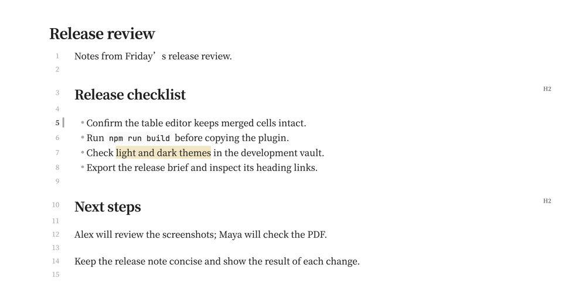
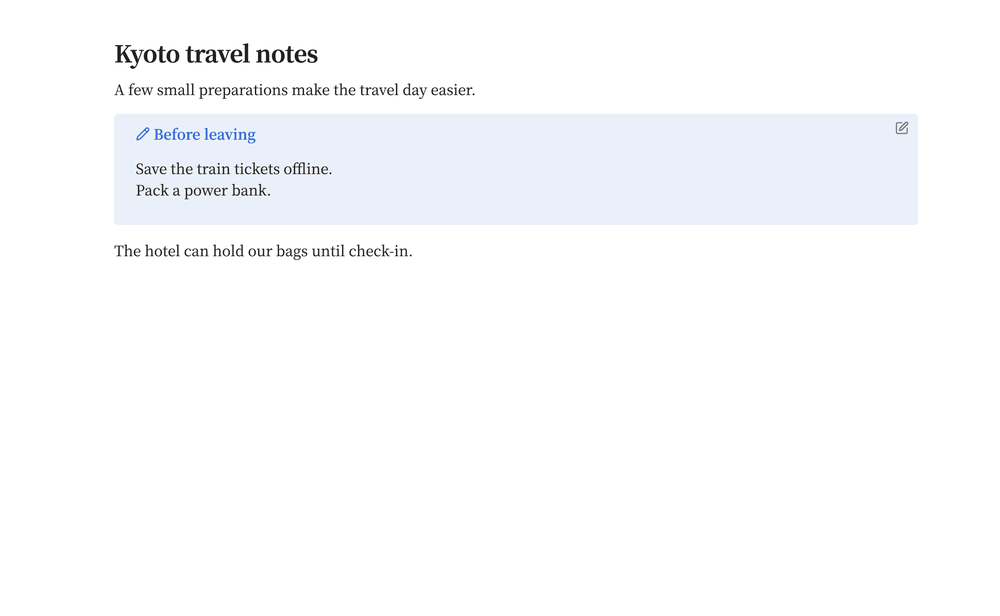
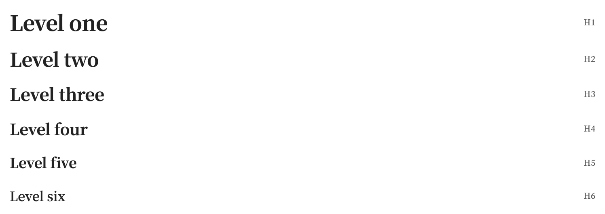
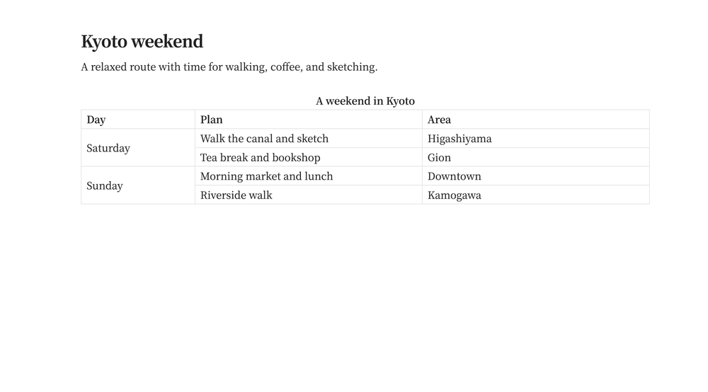
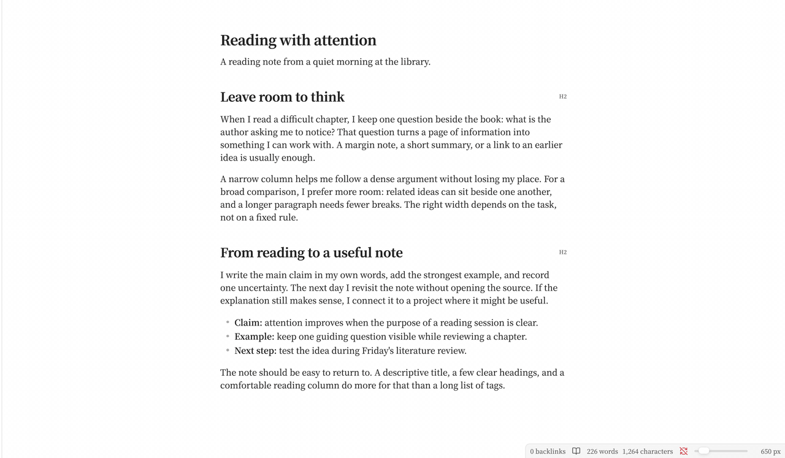
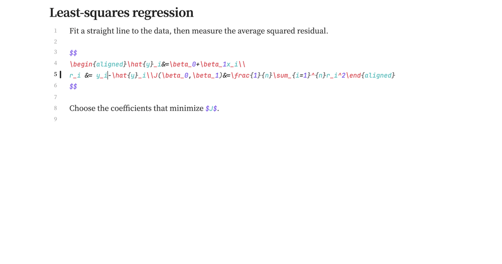
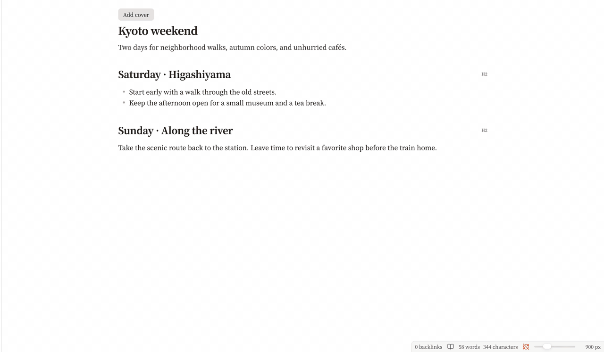
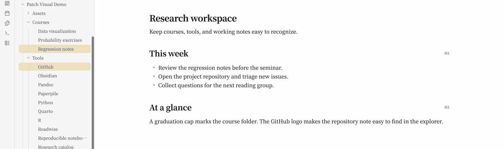
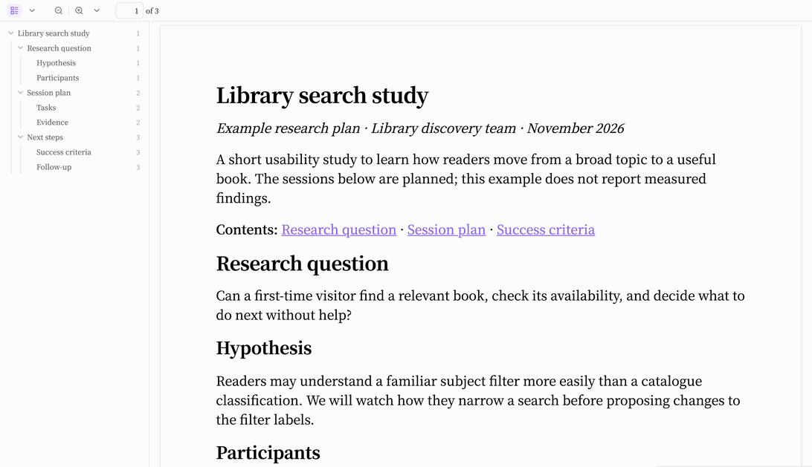

<div align="center">

# Obsidian Patch

Focused fixes and enhancements for Obsidian

[](https://obsidian.md/) [](https://github.com/yaroxy/obsidian-patch/actions/workflows/build.yml) [](LICENSE)

**[Install](#installation) · [Features](#features) · [Development](#development) · [Changelog](CHANGELOG.md)**

</div>

## Features

Configure the plugin under **Settings → Obsidian Patch**.

| Feature                           | What it does                                                                                        |
| --------------------------------- | --------------------------------------------------------------------------------------------------- |
| [Active Line](#active-line)       | Marks the cursor's line in the editor margin and highlights its line number.                        |
| [Callout Code](#callout-code)     | Tints inline code to match its surrounding callout.                                                 |
| [Callout Editor](#callout-editor) | Inserts, edits, previews, and unwraps callouts, with GitHub compatibility checks and conversion.    |
| [Heading Levels](#heading-levels) | Shows H1–H6 labels beside headings in reading and editing views.                                    |
| [HTML Tables](#html-tables)       | Converts Markdown tables to HTML and visually edits cells, merged headers, alignment, and captions. |
| [Line Width](#line-width)         | Adjusts readable line width through settings, a status bar slider, or a per-note property.          |
| [Math Format](#math-format)       | Indents and aligns display-math blocks while preserving formulas.                                   |
| [Patch Banner](#patch-banner)     | Adds vault images, animations, or videos as note covers.                                            |
| [Patch Icons](#patch-icons)       | Adds Lucide icons or Simple Icons logos to files and folders in the explorer.                       |
| [Patch Mermaid](#patch-mermaid)   | Brings newer Mermaid diagram types and syntax to notes, with selectable versions and theme support. |
| [PDF Export](#pdf-export)         | Adds heading bookmarks and same-note heading links to exported PDFs.                                |

## Installation

Requires Obsidian **1.13.7 or later**. Build with Node.js **22 or later**:

```bash
npm install
npm run build
```

Copy `main.js`, `manifest.json`, and `styles.css` to `<vault>/.obsidian/plugins/obsidian-patch/`, reload Obsidian, and enable **Obsidian Patch** under **Settings → Community plugins**.

## Active Line

A margin bar marks the cursor's line in Live Preview and Source mode, with a highlighted line number when line numbers are shown. It follows the caret color and fades in unfocused panes. Toggle **Editor → Active line** in the plugin settings; it is on by default.



## Callout Code

Inline code takes its callout's color in Reading View and Live Preview, including nested callouts and titles. Fenced code blocks keep the theme's colors. Toggle **Callouts → Inline code**; it is on by default.


## Callout Editor

Edit a callout's type, title, fold state, metadata, and content with a live preview.



- **Edit:** hover a callout in Reading View or Live Preview and click **Edit callout**.
- **Insert:** run **Obsidian Patch: Insert callout** to add one at the cursor or wrap selected lines.
- **Unwrap:** choose **Convert to text** or **Convert to blockquote** in the editor.

The command palette and editor context menu also offer editing and conversion when the cursor is in the callout's source. Header-only edits preserve the body, and saving checks for conflicting changes.

**Make GitHub-compatible** maps the type to a supported alert, moves the title into the content, and removes the fold sign and metadata:

```markdown
> [!warning|wide]- Before the morning train
> Download the tickets for offline access.
```

becomes:

```markdown
> [!WARNING]
> **Before the morning train**
> Download the tickets for offline access.
```

The GitHub panel explains remaining differences, including Obsidian-only syntax. Nested callouts must be moved to the top level manually. Set `github: true` on a note or choose **Callouts → GitHub folders** to enable the status bar count; click it or run **Check callouts for GitHub** for details.

## Heading Levels

H1–H6 labels appear beside headings in Reading View, Live Preview, and Source mode. Wrapped headings leave room for the label, and Setext headings are supported. Toggle **Editor → Heading levels**; it is on by default. Labels do not change note source or appear in exported PDFs.



## HTML Tables

Create tables with merged cells, grouped headers, and captions through a visual editor.

- **New table:** run **Obsidian Patch: Insert HTML table**.
- **Existing HTML table:** hover it and choose **Edit table**, or run **Edit HTML table** with the cursor in its source.
- **Markdown table:** place the cursor inside it, then run **Convert Markdown tables to HTML** from the command palette or editor context menu.

Try converting this table:

```markdown
| Day      | Plan                      | Area        |
| :------- | :------------------------ | :---------- |
| Saturday | Walk the canal and sketch | Higashiyama |
| Saturday | Tea break and bookshop    | Gion        |
| Sunday   | Morning market and lunch  | Downtown    |
| Sunday   | Riverside walk            | Kamogawa    |
```

Review the preview, drag across cells or Shift-click to select a range, then use **Merge cells**, **Split cell**, the row and column menus, or alignment controls. Edit the caption above the table. Choose **Convert to HTML** to apply the result; **Cancel** leaves the note unchanged.



Select several complete Markdown tables to convert them together. **Previous table** and **Next table** switch between drafts; **Convert all N tables** writes the batch in one undo step. Conversion preserves headers, alignment, common inline formatting, and links. Tables in code blocks, lists, or callouts are excluded; formulas, images, embeds, footnotes, and excess cells are rejected before anything is written.

In the editor, Tab moves between cells, Enter adds a line within a cell, and Escape leaves the cell. **Save** or Mod+Enter applies HTML-table edits. Untouched cell markup is preserved, and conflicting source changes prevent saving. Tables inside callouts and blockquotes are not detected for editing.

Both table and callout editors resize from their bottom-right corner and remember the size. Double-click the corner to reset.

## Line Width

Adjust the reading column in Reading View, Live Preview, and Source mode. Enable Obsidian's **Settings → Editor → Readable line length**, then use **Line Width** in the plugin settings or the desktop status bar slider. The default is **900 px**, with a range of **500–2000 px**; click the status bar value to reset it.



Override the width for one note:

```yaml
---
patch-line-width: 1200
---
```

A quoted value such as `"1200px"` also works. Each pane uses its note's width. The status bar disables the slider for a note with an override; an invalid value is ignored and shown in red, with a tooltip explaining the range.

## Math Format

Run **Obsidian Patch: Format math block** with the cursor inside a `$$` block, or **Format all math blocks in note**.

**Before**

```latex
$$
\begin{aligned}\hat{y}_i&=\beta_0+\beta_1x_i\\
r_i &= y_i-\hat{y}_i\\J(\beta_0,\beta_1)&=\frac{1}{n}\sum_{i=1}^{n}r_i^2\end{aligned}
$$
```

**After**

```latex
$$
\begin{aligned}
  \hat{y}_i          &=\beta_0+\beta_1x_i \\
  r_i                &= y_i-\hat{y}_i \\
  J(\beta_0,\beta_1) &=\frac{1}{n}\sum_{i=1}^{n}r_i^2
\end{aligned}
$$
```

The formatter changes whitespace while preserving formulas. It indents environments and aligns rows in `aligned`, `align`, `alignat`, `split`, `cases`, matrices, `array`, and `gathered`. Callout and list markers are preserved; unsupported or malformed blocks are left unchanged.



Under **Math Format**, choose 2 or 4 spaces of indentation and whether to align `&` and row endings. To format on lint, add **Format all math blocks in note** to Linter's custom commands.

## Patch Banner

Run **Obsidian Patch: Select cover**, or add a quoted link to an image or video in your vault:

```yaml
---
patch-banner: "[[assets/kyoto-cover.jpg]]"
---
```

Covers appear above the title and Properties in Reading View and Live Preview, at their original aspect ratio. Hover to add, change, or remove a cover; removing it clears only the property, keeping the media file.



Save the [Kyoto cover illustration](docs/images/kyoto-cover.jpg) to `assets/kyoto-cover.jpg` in your vault to try this example.

Under **Patch Banner**, adjust **Cover width (%)** from 10–100% of the pane, with a default of 90%, and toggle **Autoplay videos**. Videos are muted, loop, and pause when hidden. Reduced-motion preferences defer playback and animated images until you choose to show them.

Local images and videos are supported where the platform can decode them. Covers do not appear in Source mode, embedded notes, hover previews, Canvas, or PDF exports. Updating the property uses Obsidian's YAML serializer, which may reformat frontmatter and remove comments.

## Patch Icons

Right-click files or folders in the explorer and choose **Change icon** to pick a [Lucide](https://lucide.dev/) icon or [Simple Icons](https://simpleicons.org/) brand logo. **Remove icon** clears it; both actions support multiple selections. Icons follow the adjacent text color.



The picker downloads the latest Simple Icons from jsDelivr on first use in a session. Icons already in use are saved locally and display offline; **Patch Icons → Update** refreshes the pack. Icons follow renames and moves made inside Obsidian; changes made outside it leave the old assignment behind.

**Import from Iconize** copies supported file and folder icons, replacing existing assignments for those paths. Emoji and other packs are skipped; disable Iconize afterwards to avoid duplicate icons. **Icons of missing files** lets you clear unused assignments. Icons appear only in the file explorer.

## Patch Mermaid

Use newer Mermaid diagram types and syntax without waiting for Obsidian to update its renderer. Write a `patch-mermaid` code block and choose the bundled, latest, or a specific Mermaid version in settings.

For example, organize incident response with a [Cynefin diagram](https://mermaid.js.org/syntax/cynefin.html), introduced in Mermaid 11.16.0. This works with the default **Bundled** version and **Strict** security level:

````markdown
```patch-mermaid
cynefin-beta
  title Incident Response

  complex
    "Investigate root cause"
    "Run chaos experiment"

  complicated
    "Analyze performance data"
    "Expert review needed"

  clear
    "Restart service"
    "Apply known fix"

  chaotic
    "Page on-call immediately"

  confusion
    "Unknown failure mode"
```
````


Diagrams follow Obsidian's theme and Mermaid font. Leave `theme` unset in diagram configuration to follow light and dark mode automatically. Standard `mermaid` blocks continue to use Obsidian's renderer.

| Setting         | Choices                                                                                                                                                                       |
| --------------- | ----------------------------------------------------------------------------------------------------------------------------------------------------------------------------- |
| Mermaid version | **Bundled** (default) works offline. **Latest** fetches the newest release; **Custom** selects an exact release from 11.0.0 onward. Failed remote loads fall back to Bundled. |
| Security level  | **Strict** (default) sanitizes SVG and currently hides treeView icons. **Loose** preserves them but inserts unsanitized output; use it only with diagrams you fully trust.    |

Remote Mermaid versions load from jsDelivr without an integrity check and run with full access to Obsidian. Bundled runs the code shipped with the plugin.

Show the plugin's project structure with [treeView](https://mermaid.js.org/syntax/treeView.html). With **Bundled** selected, switch to **Loose** for this trusted example to display icons from the included `material-icon-theme` and `logos` packs:

````markdown
```patch-mermaid
treeView-beta
    obsidian-patch/ icon(material-icon-theme:folder-project)
        src/ icon(material-icon-theme:folder-src)
            features/ icon(material-icon-theme:folder-plugin)
            main.ts icon(material-icon-theme:typescript)
        manifest.json icon(material-icon-theme:json)
        styles.css icon(material-icon-theme:css)
        package.json icon(logos:nodejs-icon)
```
````

## PDF Export

Use Obsidian's **Export to PDF** on desktop. Under **PDF Export**, **Document outline** adds heading bookmarks and **Heading links** enables jumps within the note; both are on by default.



Open the [example research plan](docs/examples/library-search-study.pdf) to try the bookmarks and heading links in your PDF reader.

Links such as `[[#Session plan]]` and `[Success criteria](#success-criteria)` work, including Unicode headings and common Markdown fragments such as `#session-plan-1` for repeated headings. Wikilinks follow Obsidian's native heading matching. Links to other notes, block references, and embedded-note links retain native export behavior.

Export uses the native dialog's paper size, margins, orientation, and title options.

## Customization

<details>
<summary>Appearance tweaks with CSS snippets</summary>

Add any of these overrides to an Obsidian CSS snippet:

```css
body {
  --font-mermaid: "Inter", sans-serif;
  --obsidian-patch-active-line-color: var(--color-accent);
  --obsidian-patch-callout-code-tint: 8%;
  --obsidian-patch-icon-size: 16px;
  --obsidian-patch-icon-gap: 4px;
  --obsidian-patch-icon-offset: -0.2em;
  --obsidian-patch-icon-color: var(--text-accent);
}
```

</details>

## Development

```bash
npm run dev     # rebuild main.js on changes
npm test        # unit tests
npm run build   # type-check and build
```

See [AGENTS.md](AGENTS.md) for development conventions and feature design references. [Integration testing](docs/integration-testing.md) covers commands, prerequisites, restoration behavior, and dated verification records. Integration suites deploy the build into `dev-vault` and modify dedicated test fixtures; the new build and fixtures remain afterwards.

## Acknowledgments

**Line Width** follows the ideas of [Editor Width Slider](https://github.com/MugishoMp/obsidian-editor-width-slider) by MugishoMp (MIT), and **Patch Icons** follows [Iconize](https://github.com/FlorianWoelki/obsidian-iconize) by Florian Woelki (MIT). Their implementations are written for this plugin; the Iconize importer reads its settings format.

Icons come from [Lucide](https://lucide.dev/) (ISC), [Simple Icons](https://simpleicons.org/) (CC0 1.0), and the [Iconify](https://iconify.design/) packs used by Mermaid. Brand icons are trademarks of their respective owners.

## License

[MIT](LICENSE).
