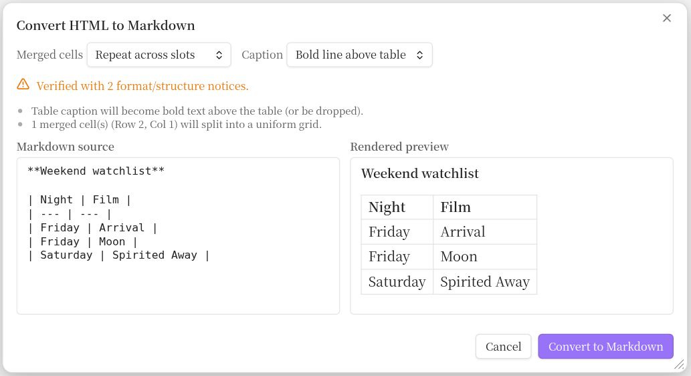
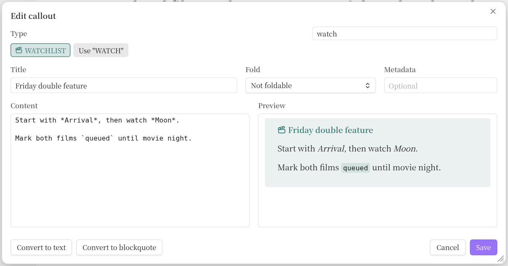

Patches can now turn an HTML table back into an ordinary Markdown table. In my weekend watchlist, one “Friday” cell spans *Arrival* and *Moon*. When I share the list, I want the day beside each film.

Place the cursor in the HTML table and run **Patches: Convert HTML tables to Markdown**. Choose **Repeat across slots** to put Friday on both rows. The preview shows the Markdown and the rendered table side by side, including what happens to the caption. On desktop you can drag the bottom-right corner for more room. After applying, one undo restores the original table.

Callouts can have their own icon and color, too. Under **Settings → Patches → Callouts → Type appearance**, I gave `WATCHLIST` a teal clapperboard. Typing `> [!watch` brings up `WATCHLIST`, and pasting several lines of plain text inside the callout keeps them quoted.

For the earlier question about phones, I tested this movie list on Linux desktop with Obsidian 1.15.1. I haven’t verified table conversion on iOS or Android yet.

You can update Patches in **Settings → Community plugins**. [Table guide and copyable watchlist](https://yaroxy.github.io/obsidian-patch/features/tables.html#convert-an-html-table-to-markdown) · [Callout appearance](https://yaroxy.github.io/obsidian-patch/features/callouts.html#type-appearance)
