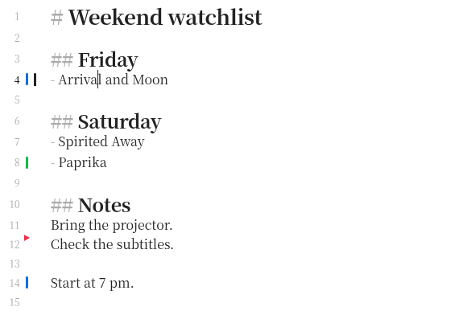
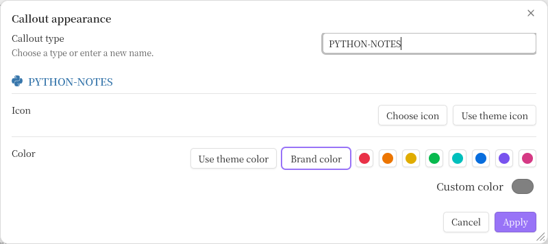

Patches 0.7.0 adds a way to see what changed in a note since your last Git commit. On desktop, open a note in a Git-backed vault. A blue mark beside a line means you edited it, green means you added it, and a red triangle shows where you removed text.

Click a marker to compare that part of the note. The upper pane shows the last commit and the lower pane follows your edits, including text you haven’t saved. If you prefer a clear margin, run **Patches: Toggle Git change markers for this vault**. You can still open the comparison from the command palette.

Callouts can now use brand logos. Open **Settings → Patches → Patch Icons → Simple Icons → Install** once, then go to **Callouts → Type appearance** and choose a logo and its brand color. The catalog works offline after installation and is shared with file and folder icons.

If you use inline code in HTML tables, the font setting now previews the family you choose and suggests installed fonts on supported devices.

[Release notes](https://github.com/yaroxy/obsidian-patch/releases/tag/0.7.0) · [Git comparison guide](https://yaroxy.github.io/obsidian-patch/reference/commands.html#compare-a-note-with-git) · [Callout appearance guide](https://yaroxy.github.io/obsidian-patch/features/callouts.html#type-appearance)
