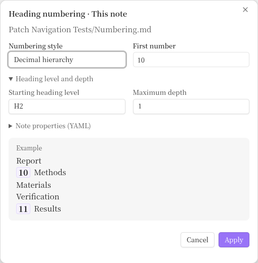

Patches 0.9.0 lets a note start its section numbers at any chapter. If you keep a report in several files, one note can start at **10 Methods** and continue with **10.1 Materials** and **11 Results**. Heading links and copied titles keep their original text.

Open the note and choose **Settings → Patches → Editor → Heading numbering → This note…**. Select **Decimal hierarchy**, enter **10** as the first number, and check the preview before choosing **Apply**. You can also paste the following property into the note.

```yaml
---
patch-heading-numbering: decimal start=10
---
```



Automatic numbers now appear in bold on a lightly tinted background in Live Preview and Reading View. On desktop, window resizing with Line Width enabled is smoother, with the same 500 px minimum between the sidebars. [Numbering guide and examples](https://yaroxy.github.io/obsidian-patch/features/heading-levels.html#per-note-numbering-options) · [0.9.0 release notes and downloads](https://github.com/yaroxy/obsidian-patch/releases/tag/0.9.0)
