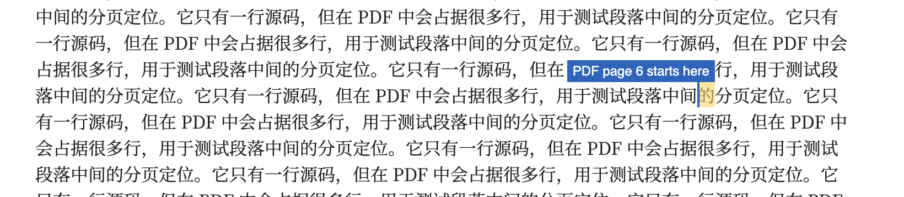

# PDF 真实页界映射实验报告

2026-11-12，阶段 1 和阶段 2。实验在 `dev-vault` 中完成。

**2026-11-12 的决定是暂缓实现 PDF 分页显示。** 11 月 18 日重新讨论的独立 PDF 预览与可供比较的插件见文末。

**真实 PDF 页界能够映射到文字内容及其源码位置，但当前方法尚不能完整覆盖所有页界。** 本次 37 个跨页边界中，32 个文字边界定位成功；其余 5 个页首包含尚未建立映射的公式或图片。正常阅读布局中的准确位置可能位于一行文字中间，不能直接表示成横贯整行的精确分页线。

## 恢复的实验和基线

源仓库基线为 `main` 的 `2f60da5`。原实验来自 Claude 会话：

`/Users/roxy/.claude/projects/-Users-roxy-Documents-workspace-obsidian-patch/62a559a8-ac13-41f5-a186-0ed4a6c738b2.jsonl`

原脚本位于：

`/private/tmp/claude-501/-Users-roxy--claude-spares-spare-Sn6c7F/62a559a8-ac13-41f5-a186-0ed4a6c738b2/scratchpad/exp/`

原样例 `dev-vault/Patch Page Tests/Pages.md` 保持原状。复现实验复制其内容和图片，并增加重复段落、重复标题、长表格、长代码、公式和折叠 Callout 样例。新入口为 `scripts/prototypes/pdf-pages/run.mjs`，说明见同目录 `README.md`。

本次环境为 macOS、Obsidian 1.15.0（installer 1.14.5）、Electron 43.8.3、Chromium 150.0.7871.250，窗口 1455 × 864 CSS px，设备像素比 2。阅读字体包含 Noto Serif SC；默认阅读段落实测宽度约 741.91 px，另测 520 px 宽度。

| 基线检查 | 本次结果 |
| --- | --- |
| `npm test` | 52 项通过 |
| `npm run build` | 通过 |
| Table 集成 | 23 项通过 |
| Callout 集成 | 41 项通过 |
| Math Format 集成 | 8 项通过 |
| Banner 集成 | 已通过 61 项，随后视频播放检查超时 |

Banner 超时发生在 `Video: full aspect ratio and playback in preview, round 1`。视频已加载（readyState 4，320 × 160），显示比例正确，但保持暂停；文档当时可见。根因尚未确认。现有 `docs/banner-testing.md` 也记录过相似现象，因此不能把本次基线写成全部通过，也不能归因于这次 PDF 实验。

## 实验依据

分页直接来自 Obsidian 原生导出的 PDF。对每组配置生成参考版与文字标记版，通过 PDF 链接注释将文字标识关联回打印 DOM 和源码，再在真实阅读视图与 CodeMirror 中定位。没有采用屏幕高度除以纸张高度的估算。

两版均使用相同的标题 ID 和同文档标题链接准备；参考版仅不包含文字标记链接。原生导出窗口拥有自己的 document，实验不依赖主窗口与导出窗口共享 IPC 对象的假设。原生大纲也可生成：原样例每版有 12 个目录项，补充样例有 9 个；这不代表所有类型的内部链接均已支持。

| 打印配置 | 原样例页数 | 补充样例页数 |
| --- | ---: | ---: |
| A4 纵向，100%，默认边距 | 7 | 8 |
| Letter 纵向，100%，默认边距 | 7 | 8 |
| A4 横向，80%，零边距 | 6 | 7 |

六组配置合计 43 页、37 个跨页边界；加上标记版，共生成 12 份 PDF。六组对照的页数、每页文字序列、文字纵向位置、图片几何位置均一致。部分字形横向边界最多变化约 **0.2543 pt**，因此通过的是本组样例的分页与行布局一致性检查，不能宣称像素完全一致或对任意文档都无影响。

Chromium 会给被页边裁切的文字留下链接矩形。实验共排除了 9725 个没有对应可见字形的矩形，避免将它们误判为页内文字。跨页表格的重复表头也被排除；“页界位置”指下一页开始的新内容位置。

## 映射结果

| 视图 | 精确定位到可见文字 | 已有源码位置但被折叠隐藏 | 页首映射尚不支持 |
| --- | ---: | ---: | ---: |
| 源码编辑器 | 32 | 0 | 5 |
| 阅读视图，当前宽度 | 29 | 3 | 5 |
| 阅读视图，520 px | 29 | 3 | 5 |
| Live Preview | 29 | 3 | 5 |

32 个文字位置均验证了对应源码片段；源码编辑器还验证了坐标反查回相同位置。阅读视图通过对应源码区块内的精确 DOM Range 定位，避免全篇搜索重复文字。Live Preview 的 29 个可见位置中，20 个直接通过 CodeMirror 文本定位，9 个通过表格或 Callout 的渲染 DOM 定位。

三处隐藏位置均在折叠 Callout 正文中。PDF 包含这些正文，但当前阅读视图和 Live Preview 不显示它们，因而没有可用的可见坐标。仅调用 `coordsAtPos()` 得到的组件边缘不等于正文中的准确位置。

五处未支持的页首分别为四处公式内容、一处图片。样例中的四个公式从公式首行开始，不是已经证明了公式内部跨页定位。原样例横向 PDF 的第 6 页先出现图片，再出现标题，后面的标题不能冒充该页边界。

### 同一页界在屏幕上可能位于行中

原样例 A4 第 6 页开始于“的分页定位……”中的“的”，对应源码 UTF-16 偏移 **6201**，即第 **154** 行、第 **1116** 列（这里行列从 1 开始）。这是一个很长的单行源码段落中的位置。

在当前阅读布局中，它位于段落左缘右侧约 **600.34 px**；在 520 px 阅读宽度中为 **424.34 px**；源码编辑器中为 **292.23 px**。三个位置均落在屏幕行中。因此，以源码行开头或屏幕整行作为分页线位置会丢失准确性。

图中黄色字符和蓝色说明是实验期间的临时测量标记。

## 重启时的研究方向

如果将来重启，宜先做范围明确的文字定位原型；目前还不具备“所有内容的精确分页线”能力。届时先约定四种结果：精确文字位置、只能定位到内容块、折叠隐藏、不支持；遇到未支持的内容时应明确显示状态。

1. 普通阅读和编辑布局使用字符旁的页码标记，并提供跳转；需要整页纸张边界时使用独立打印预览。先用这两种显示方式确认交互，再决定正式功能范围。
2. 补齐公式和图片的块级定位，并分别实验公式内部跨页、无文字页面、转义和实体、已有链接位于页首、复杂表格及嵌入内容。为每种内容定义可达到的精度，不能把后面的文字当作兜底页界。
3. 建立可靠的渲染内容到源码的映射，替换样例专用的文字、表格及单层 Callout 匹配。当前两个阅读宽度成功只说明这些样例可重新定位，不代表任意主题和插件都已适配。
4. 在接入插件前补充文档修改、字体加载、打印配置变化后的失效与重算，以及开销评估。密集文字链接使测量 PDF 明显增大；生产实现需缩减标记，或移除测量注释。当前脚本会拒绝源码已改变或标记改变了分页布局的结果。

## 结果文件和收尾

复跑命令、依赖和源映射边界见 `scripts/prototypes/pdf-pages/README.md`。紧凑结果保存在 `scripts/prototypes/pdf-pages/results/2026-11-12.json`，原始 PDF、逐页解析、DOM 坐标和截图位于：

`/private/tmp/obsidian-patch-pdf-20261112/experiment/`

基线日志位于其上级目录。临时目录可能被系统清理，紧凑结果、脚本、样例和本报告保留在仓库中。

本次新增内容为实验脚本、样例和报告，未实现生产分页功能。基线测试在 `dev-vault` 部署了当前构建；插件设置已按备份逐字恢复。实验标签页已关闭、原阅读笔记已恢复、调试器已断开、后台节流恢复为原值，最后的 Obsidian 错误记录为 `No errors captured.`。开发结果保存在任务报告中，未加入长期项目记忆。

## 独立标签页 PDF 预览调研（2026-11-18）

已有 Obsidian 插件能边写边看纸面排版，也有插件能局部排版并替换真实 PDF 的页面。它们采用的排版引擎决定了用户看到的是哪一种导出结果。下表核对了对应发行版本的源码和作者文档。

| 插件 | 编辑时能看到什么 | 分页与导出如何对应 |
| --- | --- | --- |
| Live PDF Preview 1.3.4 | 普通 Markdown 在右侧栏随输入刷新，包括尚未保存的编辑。光标前的文本相同时，复用这部分已渲染的 HTML。 | 预览按纸张尺寸重新构造 HTML 页，点击导出后才把这些页面交给 Electron 生成 PDF。[编辑与缓存](https://github.com/kimsunin/obsidian-live-pdf-preview/blob/1.3.4/src/view.ts#L471-L553) · [分页](https://github.com/kimsunin/obsidian-live-pdf-preview/blob/1.3.4/src/pagination.ts#L305-L351) · [导出](https://github.com/kimsunin/obsidian-live-pdf-preview/blob/1.3.4/src/export.ts#L445-L565) |
| Print Studio 0.4.7 | 修改纸张或样式时，打印面板自动更新。改了笔记正文后，在面板点 **Refresh note** 重新取内容。 | iframe 展示插件生成的分页 HTML。预览缩放独立于导出纸张尺寸。[渲染源码](https://github.com/5krus/obsidian-print-studio/blob/0.4.7/src/panel.ts#L457-L474) · [使用说明](https://github.com/5krus/obsidian-print-studio/blob/0.4.7/docs/GUIDE.md#L83-L96) |
| PDF Preview Print 1.0.6 | 打开导出对话框时可取编辑器中未保存的正文，改变打印选项会刷新预览。 | 它自己组装打印文档，在隐藏的 Electron 视图生成 PDF，用 PDF.js 显示各页，再把同一份 PDF 字节保存。这个做法可保证预览与该插件的导出一致。[正文读取](https://github.com/H9-G/pdf-preview-print/blob/1.0.6/src/render.ts#L12-L24) · [生成、预览与保存](https://github.com/H9-G/pdf-preview-print/blob/1.0.6/src/modal.ts#L181-L265) |
| qmd as md 0.4.3 | `.qmd` 保存后由本机 `quarto preview` 自动重编。启用选项后，位于 `_quarto.yml` 项目内的 `.md` 也支持。 | 当 Quarto 输出 PDF 时，可在右侧 Obsidian 原生 PDF 阅读器复用同一标签页。Typst 或 LaTeX 决定最终版式。[预览及适用范围](https://github.com/danieltomasz/qmd-as-md-obsidian/blob/0.4.3/README.md#L76-L115) |
| LaTeX 0.1.2 | Markdown 章节保存后，驻留的 LuaLaTeX 进程重排受影响的小节，把生成的页拼入上一次完整 PDF。右侧标签页显示更新后的 PDF。 | 它能读取上次排版留下的分页状态与计数器。后续页码或布局可能受影响时会标记这些页，随后用整本编译校正。这是实际的局部 PDF 更新，依赖 LaTeX 的排版状态。[快速预览与 PDF 窗格](https://github.com/Gameboard-dev/latex/blob/0.1.2/docs/builds-and-preview.md#L55-L103) · [页面拼接源码](https://github.com/Gameboard-dev/latex/blob/0.1.2/core/src/splice.rs#L329-L340) |
| Typst Live 0.1.1 | `.typ` 修改后，Tinymist 用未保存的内容更新侧栏中的 SVG，并支持从预览跳回源码。 | Typst 用依赖跟踪和缓存复用计算结果，独立预览可以消费 SVG。这一版插件把 PDF 导出留给 Typst 或 Tinymist。[侧栏和输入](https://github.com/qiulinfan/obsidian-tinymist/blob/0.1.1/README.md#L15-L35) · [发行版限制](https://github.com/qiulinfan/obsidian-tinymist/blob/0.1.1/README.md#L146-L151) · [Typst 的设计](https://github.com/typst/typst#design-principles) |

**值得评审的范围是让普通 `.md` 在独立标签页显示 Obsidian 原生「导出为 PDF」的结果。** 上述实现各自覆盖了输入时刷新、真实 PDF 字节或局部重排。本次核对的发行版中，尚未找到同时使用原生笔记打印流程、跟随正文修改、并提供局部 PDF 重排的实现。Patches 的已有实验能从桌面端原生导出窗口取得完整 PDF，使用的是宿主未公开的 `printToPdfDesktop` 方法。该实验读取已保存笔记，尚未验证原生方法如何处理未保存的编辑。[原生导出实验](../scripts/prototypes/pdf-pages/export.js) · [Patches 的宿主适配](heading-and-pdf-design.md#宿主方法的适配)

**纸张尺寸与预览宽度可以分开。** 假设打印视口固定为 A4、纵向、给定页边距及打印缩放，拖窄右侧标签页只需把同一页 PDF 缩小。改成 Letter、横向或不同页边距，或修改打印样式、字体、图片和正文，都可能触发重排。开头增加一行可能让此后的多个分页点一起移动。Electron 的 `printToPDF` 返回本次生成的 PDF 数据，`pageRanges` 用于选择输出哪些页，公开接口没有提供从上一次排版断点恢复的能力。[Electron 打印接口](https://www.electronjs.org/docs/latest/api/web-contents#contentsprinttopdfoptions) · [本项目六组打印对照](../scripts/prototypes/pdf-pages/results/2026-11-12.json)

**建议先验证整份原生 PDF 能否足够快地刷新。** 桌面原型可从已保存的笔记开始，将连续保存合并为一次导出，同时最多运行一次，排队时只保留最新版本。预览在原页保留上一次成功结果，明确标出“更新中”或“更新失败”。只有笔记和打印设置仍匹配才显示新结果。用户点击导出时可以直接保存屏幕上这份最新 PDF。要支持停笔即见未保存的改动，还需验证原生打印流程拿到的是同一版正文，并等到字体、图片和 Mermaid 就绪。

一次可供决策的小实验是复用两篇既有样例，分别在首页和末页增删一段，更换一张图片，再把 A4 改成 Letter。记录冷启动以及重复编辑从保存到第一张可见新页的耗时（中位数和 P95），用同一修订的手动原生导出核对页数、逐页文字、公式和图片的位置，并核对 Patches 的标题书签与跳转。拖窄预览应保持页数及页内位置，连续保存应只显示最新结果。11 月 12 日的 43 页样本验证了页界映射和打印对照。实时刷新延迟、资源消耗和当前宿主版本的输出一致性仍待实测。是否值得实现逐页缓存，可以等这组数据再决定。[原型和既有测量范围](../scripts/prototypes/pdf-pages/README.md)
