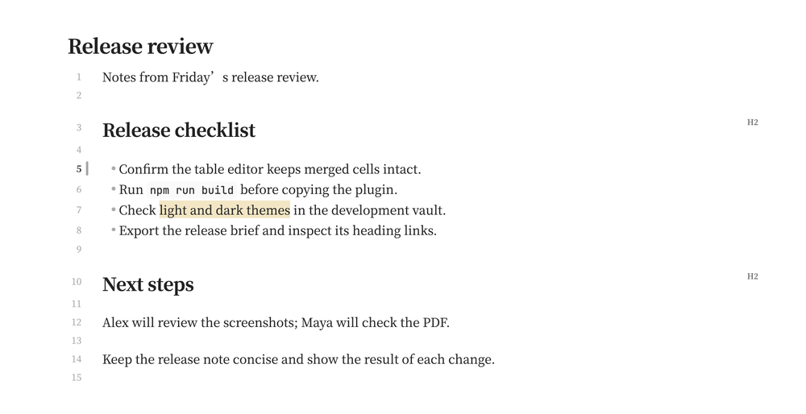

# Active line

A margin bar marks the cursor's line in Live Preview and Source mode, with a highlighted line number when line numbers are shown. It follows the caret color and fades in unfocused panes. Toggle **Editor → Active line** in the plugin settings; it is on by default.

## Where it works

Live Preview and Source mode. The marker follows the cursor, so it does not appear in Reading View or PDF output.
