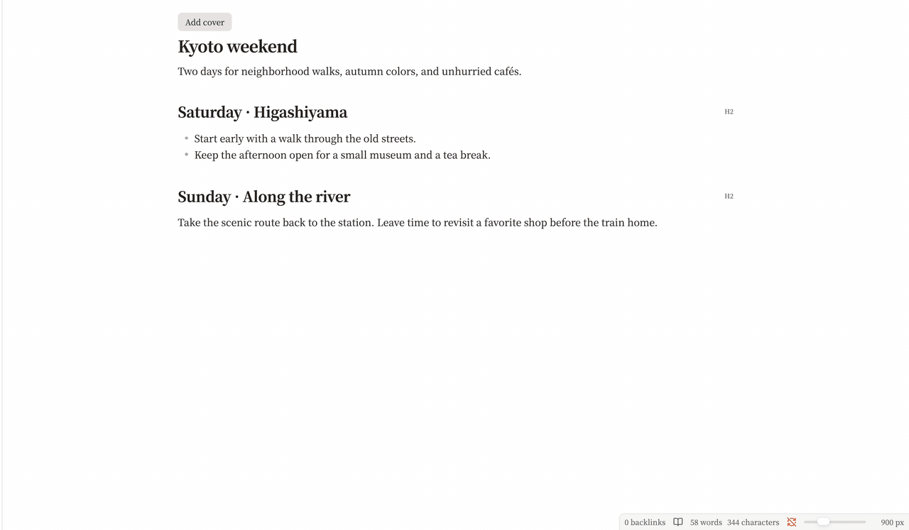

# Banners

Run **Patches: Select cover**, or add a quoted link to an image or video in your vault:



```yaml
---
patch-banner: "[[assets/kyoto-cover.jpg]]"
---
```

The cover picker lists vault file paths locally to find images and videos. These paths are not sent to a remote service.

Covers appear above the title and Properties in Reading View and Live Preview, at their original aspect ratio. Hover to add, change, or remove a cover; removing it clears only the property, keeping the media file.

Save the [Kyoto cover illustration](/examples/kyoto-cover.jpg) to `assets/kyoto-cover.jpg` in your vault to try this example.

Under **Patch Banner**, adjust **Cover width (%)** from 10–100% of the pane, with a default of 90%, and toggle **Autoplay videos**. Videos are muted, loop, and pause when hidden. Reduced-motion preferences defer playback and animated images until you choose to show them.

Local images and videos are supported where the platform can decode them. Covers do not appear in Source mode, embedded notes, hover previews, Canvas, or PDF exports. Updating the property uses Obsidian's YAML serializer, which may reformat frontmatter and remove comments.

## If a cover does not appear

Check that the media is inside the vault, the property is a quoted link, and the note is open in Reading View or Live Preview. See [banner troubleshooting](../troubleshooting.md#my-banner-does-not-appear).
