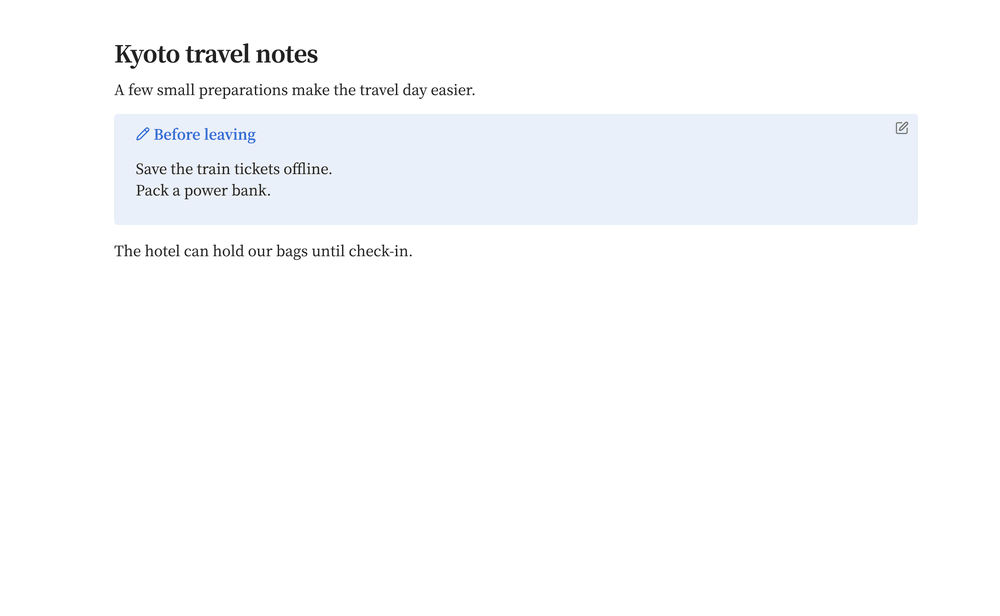
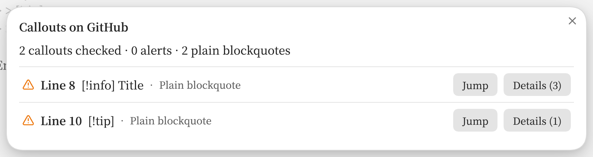
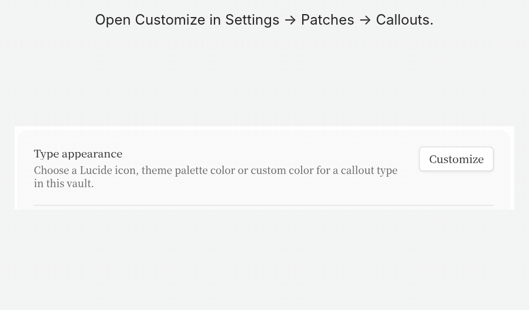
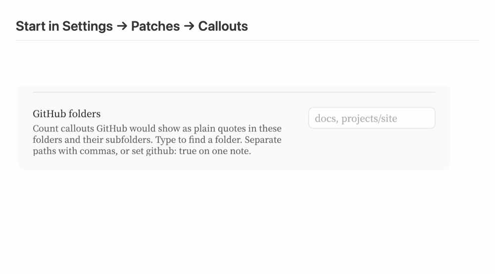

# Callouts

Edit a callout's type, title, fold state, metadata, and content side by side with a live preview.



- **Edit:** hover a callout in Reading View or Live Preview and click **Edit callout**, or run **Patches: Edit callout** inside its source.
- **Insert:** run **Patches: Insert callout** to choose a header and insert a callout at the cursor or wrap selected lines.
- **Unwrap:** choose **Convert to text** or **Convert to blockquote** in the editor.

## Type completion and paste

In Patches 0.6.0 or later, type `> [!tip` in the editor and choose **TIP** to insert `> [!TIP]`. In the callout editor, search by name or alias, or enter a new type. Aliases with the same appearance share a group. Pasting multiline plain text inside the body adds the callout’s `>` markers to each line.

Patches writes uppercase markers when you insert a callout, wrap a selection, or choose a type. Reselecting an existing `[!tip]` changes it to `[!TIP]`. A custom name whose uppercase form would resolve to a different Obsidian type keeps its spelling. Editing only the title or fold state preserves both the marker’s spelling and the original body. If another edit changes the callout while the dialog is open, saving keeps your draft open.

## GitHub compatibility

**Make GitHub-compatible** maps the type to a supported alert, moves the title into the content, and removes the fold sign and metadata:

```markdown
> [!warning|wide]- Before the morning train
> Download the tickets for offline access.
```

becomes:

```markdown
> [!WARNING]
> **Before the morning train**
> Download the tickets for offline access.
```

The GitHub panel explains remaining differences, including Obsidian-only syntax. Nested callouts must be moved to the top level manually. Set `github: true` on a note or choose **Callouts → GitHub folders** to enable the status bar count. Click the count or run **Check callouts for GitHub** to open the note’s report.

In 0.5.0, the command reads the saved note in Reading view and includes unsaved edits in the editor. Each row shows the note line, header, and whether GitHub displays an alert or a plain blockquote. **Details (3)** opens the three reasons for that row. **Jump** moves the cursor to the header in the editor or scrolls to the callout in Reading view. If the note changes, run the command again for current line numbers.



## Type appearance

In Patches 0.6.0 or later, open **Settings → Patches → Callouts → Type appearance → Customize**. To reproduce the movie-night example, enter `watchlist`, choose the `clapperboard` icon and set **Custom color** to `#327771`. Click **Apply**. Both `> [!WATCHLIST]` and a hand-typed `> [!watchlist]` use this appearance. You can also pick one of eight theme colors. Each type has its own settings, including built-in aliases. To reset it, select **Use theme icon** and **Use theme color** and apply.

<picture>
  <source media="(prefers-reduced-motion: reduce)" srcset="../../docs/images/watchlist-callout-editor.png">
  
</picture>

GitHub supports the five alert markers `[!NOTE]`, `[!TIP]`, `[!IMPORTANT]`, `[!WARNING]` and `[!CAUTION]` and supplies their visual appearance.

## Code backgrounds

::: info Version availability
Code-block background tinting and the renamed **Code background** toggle are available in **0.4.0 and later**. Earlier versions tint inline code.
:::

Inline code and code block backgrounds use a translucent layer of the nearest callout’s color (12% by default), including a palette or custom color. This applies in Reading View and Live Preview. Syntax highlighting keeps the theme's colors, and inline code in a title follows the title's text color. Toggle **Callouts → Code background**; it is on by default.


The recording switches **Code background** off and on in both themes. The outer warning and nested tip each supply their own background color; the JavaScript/Python highlighting and code outside the callout stay unchanged within each theme.

Try the nested example in a note:

````markdown
> [!WARNING] Before deploying `preview`
> Keep `dryRun` enabled while checking the output.
>
> ```javascript
> const options = { dryRun: true };
> await deploy(options);
> ```
>
> > [!TIP] Check the preview first
> > ```python
> > print("Preview ready")
> > ```
````

## GitHub folders

With **GitHub compatibility** enabled, choose a vault folder to count the callouts GitHub would show as plain blockquotes in its notes and subfolders. In 0.5.0, type part of a folder path and click a match, or use the arrow keys and press **Enter**. **Esc** closes the suggestions. Use a comma to add another folder, or move the cursor back to replace an earlier entry. The field also accepts manually entered paths such as `docs, projects/site`. Commas separate entries, so paths containing a comma cannot be selected.

The recording selects `Patch Callout Tests`. A note in its `Guides` subfolder contains a supported `[!NOTE]` and an Obsidian `[!example]`. Click the **1/2** status bar count, then **Details (2)** on line 4 to read why GitHub displays that callout as a plain blockquote. All checks run in the vault. For a single note, set `github: true` in its properties.


