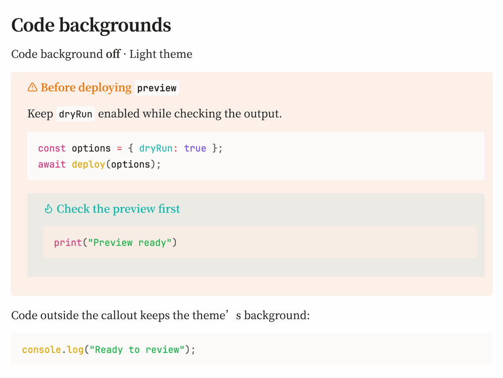

# Callouts

Edit a callout's type, title, fold state, metadata, and content with a live preview.


- **Edit:** hover a callout in Reading View or Live Preview and click **Edit callout**.
- **Insert:** run **Patches: Insert callout** to add one at the cursor or wrap selected lines.
- **Unwrap:** choose **Convert to text** or **Convert to blockquote** in the editor.

The command palette and editor context menu also offer editing and conversion when the cursor is in the callout's source. Header-only edits preserve the body, and saving checks for conflicting changes.

## GitHub compatibility

**Make GitHub-compatible** maps the type to a supported alert, moves the title into the content, and removes the fold sign and metadata:

```markdown
> [!warning|wide]- Before the morning train
> Download the tickets for offline access.
```

becomes:

```markdown
> [!WARNING]
> **Before the morning train**
> Download the tickets for offline access.
```

The GitHub panel explains remaining differences, including Obsidian-only syntax. Nested callouts must be moved to the top level manually. Set `github: true` on a note or choose **Callouts → GitHub folders** to enable the status bar count; click it or run **Check callouts for GitHub** for details.

## Code backgrounds

::: info Version availability
Code-block background tinting and the renamed **Code background** toggle are available in **0.4.0 and later**. Earlier versions tint inline code.
:::

Inline code and code block backgrounds take their callout's color in Reading View and Live Preview, including nested callouts. Syntax highlighting keeps the theme's colors, and inline code in a title follows the title's text color. Toggle **Callouts → Code background**; it is on by default.



The recording switches **Code background** off and on in both themes. The outer warning and nested tip each supply their own background color; the JavaScript/Python highlighting and code outside the callout stay unchanged within each theme.

Try the nested example in a note:

````markdown
> [!warning] Before deploying `preview`
> Keep `dryRun` enabled while checking the output.
>
> ```javascript
> const options = { dryRun: true };
> await deploy(options);
> ```
>
> > [!tip] Check the preview first
> > ```python
> > print("Preview ready")
> > ```
````

## GitHub folders

Use comma-separated vault-relative folders, such as `docs, projects/site`, to enable compatibility counting for those folders and their descendants. A note can also opt in with `github: true`. This setting checks callouts; it does not connect a repository, upload notes, or configure a website. Leave the folder list empty if you do not need folder-wide checks.
