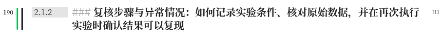
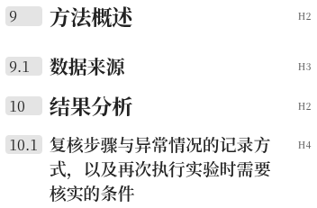
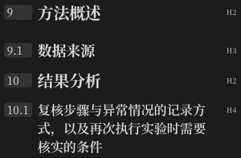
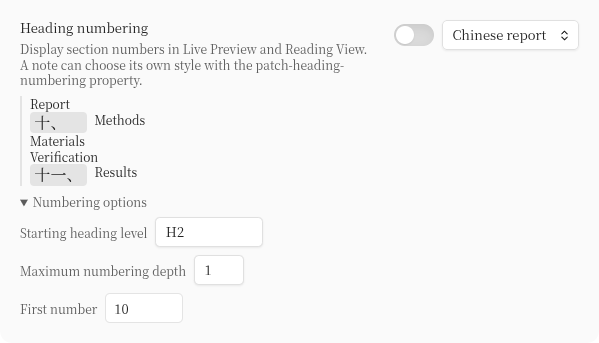

# Heading levels

H1–H6 labels appear beside headings in Reading View, Live Preview, and Source mode. Wrapped headings leave room for the label, and Setext headings are supported. Toggle **Editor → Heading levels**; it is on by default. Labels do not change note source or appear in exported PDFs.

In Live Preview, a body heading shares its extra spacing evenly above and below the text. Reading View also balances the extra margins around a heading that follows a paragraph, quote, code block, table or list. On a wrapped heading, both the section number and the H1–H6 label sit beside the first line. The active-line bar in the editor spans the wrapped title.




## Where it works

Reading View, Live Preview, and Source mode. Exported PDFs use the note’s headings without the visual H1–H6 labels.

## Heading numbering

The development build can display section numbers in Live Preview and Reading View. Enable **Settings → Patches → Editor → Heading numbering** for the vault, or add the following property to just one note. The vault setting starts off.

```yaml
---
patch-heading-numbering: decimal
---
```

| Property value | Example sequence |
| --- | --- |
| `decimal` | 1 Methods → 1.1 Materials → 2 Results |
| `zh-report` | 一、方法 → （一）材料 → 二、结果 |
| `en-outline` | I. Methods → A. Materials → II. Results |
| `continuous` | 1 Methods → 2 Materials → 3 Results |
| `false` | Turns numbering off for this note |

A single H1 at the beginning serves as the document title. The first section below it starts at 1. A skipped heading level attaches to the closest preceding higher heading. Code examples, callouts, block quotes and embedded notes do not consume numbers. **Numbering options** sets the starting heading level, maximum depth and first number. The sample updates as you change these settings.

The fold arrow stays on the leading side of the shaded number, with its own click target. Numbers follow the vault’s text font. Changing that font updates the shared column width. Automatic numbers such as **9**, **10** and **10.1** align at the start of a shared column. Each automatic number has a subtle background that follows your theme and distinguishes it from a number typed into the title. The title and its wrapped lines align in the next column.



<details>
<summary>Dark mode</summary>



</details>

The settings preview below starts a Chinese report at chapter ten and limits numbering to one level. “Methods” and “Results” receive chapter numbers while the headings between them keep their original text.



A matching handwritten number appears once, including in a wiki link alias or Markdown reference link label. A conflicting number such as **7.3 Background** where **1.2** is expected pauses automatic prefixes across that note. Open the numbering setting with the note active to see the line and expected number. Correcting the heading resumes numbering. Markdown source, copied text, heading links and exported PDFs use the original titles.
