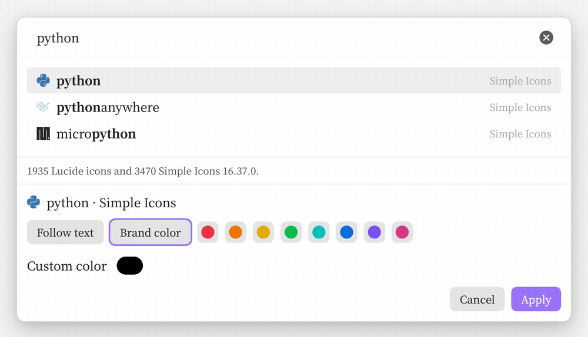

# File & folder icons

::: info Version availability
Color controls are available in **0.4.0 and later**. Earlier versions support icon selection without color controls.
:::

Right-click files or folders in the explorer and choose **Change icon** to pick a [Lucide](https://lucide.dev/) icon or [Simple Icons](https://simpleicons.org/) brand logo. Preview the icon and color together, then choose **Apply**. Colors include **Follow text**, **Brand color** when available, eight theme-aware presets, and a custom color. Existing icons keep their appearance; new brand selections use their brand color when available. **Cancel** discards the selection. **Remove icon** clears the icon and its color; both actions support multiple selections. For a selection with different icons, choosing only a color keeps each existing icon.

The recording shows **Brand color → Green preset → Custom color** in the same panel. Choose **Apply** to save the icon and color together, or **Cancel** to leave the file unchanged.

The picker stays centered with space above and below it. Search results scroll independently, keeping the color controls and Apply/Cancel visible.

In 0.7.0, a one-time tip explains where to get optional brand logos. Select **Settings → Patches → Patch Icons → Simple Icons → Install** for the first download. The same button then reads **Update**. Patches keeps one compressed copy in its plugin folder. After restarting, both the explorer and [Callout appearance](callouts.md#type-appearance) can search it offline. Before installation, both pickers offer Obsidian’s Lucide icons and previously assigned brand icons. If an update fails, the previous catalog remains usable.

In 0.6.0, the picker downloads the latest Simple Icons graphic data from jsDelivr on first use in a session, plus brand-color JSON from the corresponding upstream Simple Icons version. These are image and color data, not executable modules. Icons and brand colors already in use are saved locally and display offline; **Patch Icons → Update** refreshes the pack. If color metadata is unavailable, cached brand colors remain usable and other icons can still use text, preset, or custom colors. Simple Icons provides single-color brand marks, so **Brand color** does not recreate multicolor logos. Icons and colors follow renames and moves made inside Obsidian; changes made outside it leave the old assignment behind.

**Import from Iconize** copies supported file and folder icons, replacing existing assignments for those paths. Emoji and other packs are skipped; disable Iconize afterwards to avoid duplicate icons. **Icons of missing files** lets you clear unused assignments. In 0.5.0, it lists each missing vault-relative path before removal. File and folder assignments appear in the file explorer.

## Keyboard and batch editing

Enter in the search field selects the highlighted icon. Tab to a color button, Apply, or Cancel, then press Enter to activate it. Escape closes the picker.

When selected files have different colors, **Keep colors** preserves each one while you change their icons. Pick a preset or custom color to give all selected items one color. Returning to **Keep colors** before Apply restores the individual-color choice.

See [network and privacy](../privacy.md) for download details.
