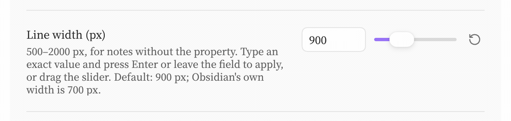

# Line width

::: info Version availability
The numeric input and 1 px slider steps are available in **0.4.0 and later**. Exact per-note widths are also supported in earlier versions.
:::

Adjust the reading column in Reading View, Live Preview, and Source mode. Enable Obsidian's **Settings → Editor → Readable line length**, then use **Line Width** in the plugin settings or the desktop status bar slider. In settings, type an exact whole number and press Enter or leave the field to apply it; the input and slider stay in sync. Both sliders adjust in 1 px steps. The default is **900 px**, with a range of **500–2000 px**; use the settings reset button or click the status bar value to reset it.

The value is the **maximum** column width. In Reading View, a 1306 px pane with 32 px of padding on each side has room for about 1242 px of text. A 1400 px setting reaches its full width when the pane is wide enough.



In **Settings → Patches → Line Width**, replace **900** with **1137** and press Enter. The slider moves to the exact value; the reset button returns both controls to **900 px**.

Override the width for one note:

```yaml
---
patch-line-width: 1200
---
```

A quoted value such as `"1200px"` also works. Each pane uses its note's width. The status bar disables the slider for a note with an override; an invalid value is ignored and shown in red, with a tooltip explaining the range.

## Desktop window width

In the development build, enabling **Line Width** also reserves 500 CSS pixels for the entire central workspace in the main desktop window. Dragging the window narrower first reduces the space available to expanded sidebars. Each keeps its minimum width (200 px in the default desktop layout). At that point the window reaches its minimum. The window minimum includes the theme’s column gaps and any larger sidebar minimum. Collapsing a sidebar lets the window get narrower, and widening it restores the preferred widths of open sidebars. Individual panes inside the central workspace can be narrower than 500 px.

## Settings

| Setting | Default | Effect |
| --- | --- | --- |
| Enabled | On | Applies Patches’ readable width to Markdown panes. |
| Line width | 900 px | Global fallback for notes without a valid override. |
| Show in status bar | On | Shows the desktop slider and reset value. |

A note with `patch-line-width` keeps its override when you change the global setting. If nothing changes, see [width troubleshooting](../troubleshooting.md#line-width-does-not-change).
