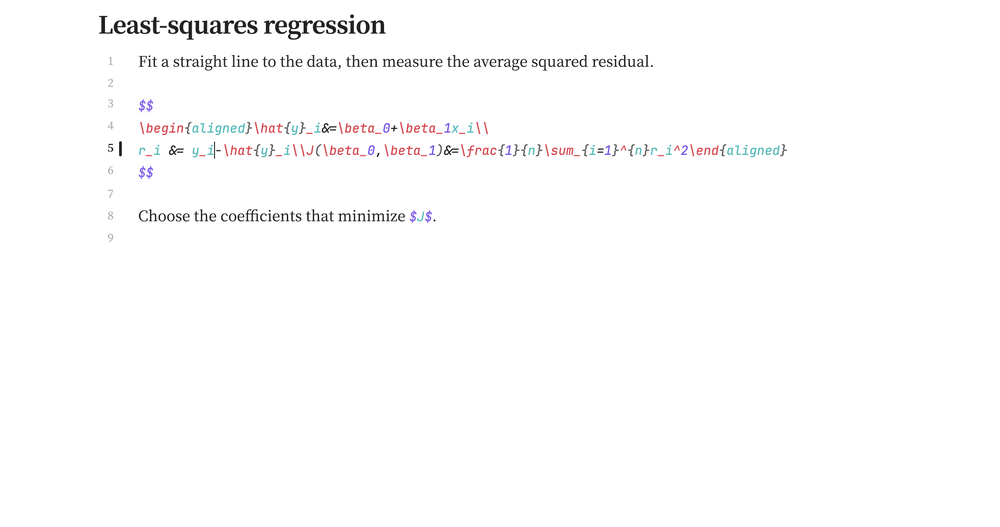

# Math formatting

Run **Patches: Format math block** with the cursor inside a `$$` block, or **Format all math blocks in note**.



**Before**

```latex
$$
\begin{aligned}\hat{y}_i&=\beta_0+\beta_1x_i\\
r_i &= y_i-\hat{y}_i\\J(\beta_0,\beta_1)&=\frac{1}{n}\sum_{i=1}^{n}r_i^2\end{aligned}
$$
```

**After**

```latex
$$
\begin{aligned}
  \hat{y}_i          &=\beta_0+\beta_1x_i \\
  r_i                &= y_i-\hat{y}_i \\
  J(\beta_0,\beta_1) &=\frac{1}{n}\sum_{i=1}^{n}r_i^2
\end{aligned}
$$
```

The formatter changes whitespace while preserving formulas. It indents environments and aligns rows in `aligned`, `align`, `alignat`, `split`, `cases`, matrices, `array`, and `gathered`. Callout and list markers are preserved; unsupported or malformed blocks are left unchanged.

Under **Math Format**, choose 2 or 4 spaces of indentation and whether to align `&` and row endings. To format on lint, add **Format all math blocks in note** to Linter's custom commands.

## Working with selections

Use **Format math block** for the block at the cursor, or **Format all math blocks in note** for the current note. Review the result in your normal math renderer; Patches formats source and does not replace MathJax.
