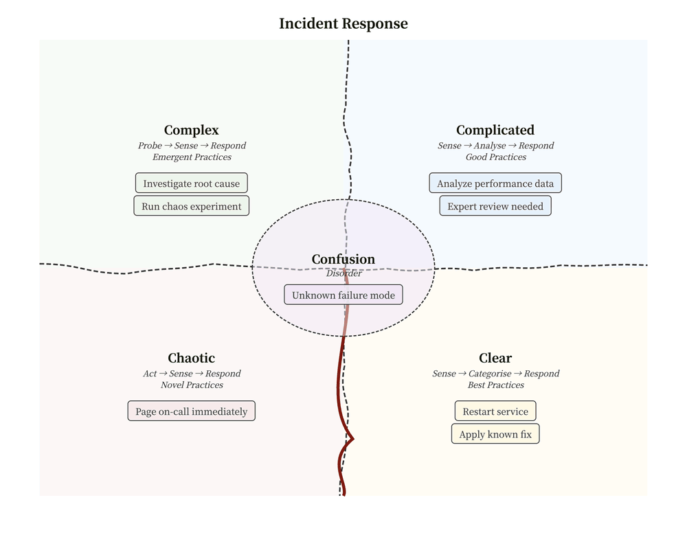

# Mermaid diagrams

Use newer Mermaid diagram types and syntax without waiting for Obsidian to update its renderer. Write a `patch-mermaid` code block. The community build uses the Mermaid version bundled with Patches, updated through plugin releases; the full build also offers remote versions.



For example, organize incident response with a [Cynefin diagram](https://mermaid.js.org/syntax/cynefin.html), introduced in Mermaid 11.16.0. This works with the default **Bundled** version and **Strict** security level:

````markdown
```patch-mermaid
cynefin-beta
  title Incident Response

  complex
    "Investigate root cause"
    "Run chaos experiment"

  complicated
    "Analyze performance data"
    "Expert review needed"

  clear
    "Restart service"
    "Apply known fix"

  chaotic
    "Page on-call immediately"

  confusion
    "Unknown failure mode"
```
````

Diagrams follow Obsidian's theme and Mermaid font. Leave `theme` unset in diagram configuration to follow light and dark mode automatically. Standard `mermaid` blocks continue to use Obsidian's renderer.

| Setting         | Choices                                                                                                                                                                       |
| --------------- | ----------------------------------------------------------------------------------------------------------------------------------------------------------------------------- |
| Mermaid version | **Community:** the bundled version is shown. **Full:** choose **Bundled** (default), **Latest**, or **Custom** (an exact version from 11.0.0 onward). Failed remote loads fall back to Bundled. |
| Security level  | **Strict** (default) restricts diagram content and currently hides treeView icons. **Loose** allows additional content and interactions; use it only with diagrams you fully trust. Both modes sanitize the generated SVG before display. |

Some bundled icons, including `material-icon-theme:folder-css` and `logos:chrome-web-store`, currently render incompletely because of Mermaid's own icon filtering, even in Loose mode.

In the full build, remote Mermaid and ELK versions load from jsDelivr without an integrity check and run with full access to Obsidian. The community build excludes this remote loader and uses the code shipped with the plugin, even if old settings selected Latest or Custom. Simple Icons may still download icon data; see [network and privacy](../privacy.md).

Show the plugin's project structure with [treeView](https://mermaid.js.org/syntax/treeView.html). With **Bundled** selected, switch to **Loose** for this trusted example to display icons from the included `material-icon-theme` and `logos` packs:

````markdown
```patch-mermaid
treeView-beta
    obsidian-patch/ icon(material-icon-theme:folder-project)
        src/ icon(material-icon-theme:folder-src)
            features/ icon(material-icon-theme:folder-plugin)
            main.ts icon(material-icon-theme:typescript)
        manifest.json icon(material-icon-theme:json)
        styles.css icon(material-icon-theme:css)
        package.json icon(logos:nodejs-icon)
```
````

## Which build should I use?

Use the Community build for normal installation. It bundles Mermaid with the plugin and updates through Patches releases. Full is an optional manual source build; its [branch documentation](https://github.com/yaroxy/obsidian-patch/tree/codex/full) covers the extra runtime choices. See [network and privacy](../privacy.md).
