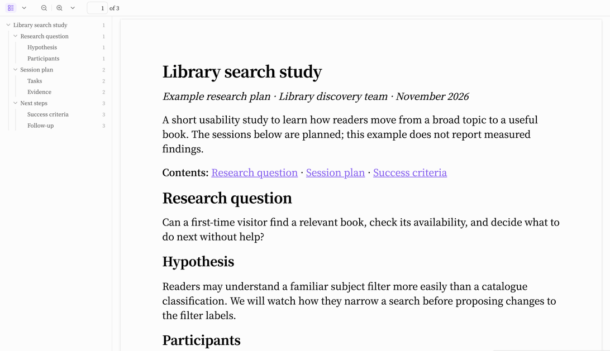

# PDF navigation

Use Obsidian's **Export to PDF** on desktop. Under **PDF Export**, **Document outline** adds heading bookmarks and **Heading links** enables jumps within the note; both are on by default.

Open the [example research plan](/examples/library-search-study.pdf) to try the bookmarks and heading links in your PDF reader.

Links such as `[[#Session plan]]` and `[Success criteria](#success-criteria)` work, including Unicode headings and common Markdown fragments such as `#session-plan-1` for repeated headings. Wikilinks follow Obsidian's native heading matching. Links to other notes, block references, and embedded-note links retain native export behavior.

Export uses the native dialog's paper size, margins, orientation, and title options.

## Platform

This enhancement uses Obsidian’s native desktop PDF export. It does not replace the PDF renderer or change the export layout. Mobile export is outside this feature’s scope.
