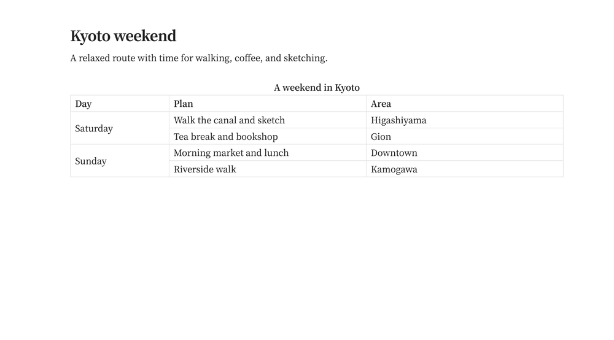

# HTML tables

Create tables with merged cells, grouped headers, and captions through a visual editor.



- **New table:** run **Patches: Insert HTML table**.
- **Existing HTML table:** hover it and choose **Edit table**, or run **Edit HTML table** with the cursor in its source.
- **Markdown to HTML:** place the cursor inside a Markdown table (or select complete tables), then run **Convert Markdown tables to HTML** from the command palette or editor context menu.
- **HTML to Markdown:** run **Convert HTML tables to Markdown** from the command palette or editor context menu, or choose **Convert to Markdown** inside the visual table editor. The confirmation modal previews the Markdown source and rendered table side by side, lets you choose how merged cells, headerless tables, and captions convert, lists any structural differences, and verifies the rendered output before writing in a single undo step.

In the upcoming release, open **Settings → Patches → HTML Tables → Inline code font** and enter an installed family name such as `JetBrains Mono`. Press Enter or leave the field to apply it to inline code in standalone HTML table cells in Reading View, Live Preview and the visual editor. Clear the field to use the theme font again. The font preference is local to this vault and the font must be available on each device.

Try converting this table:

```markdown
| Day      | Plan                      | Area        |
| :------- | :------------------------ | :---------- |
| Saturday | Walk the canal and sketch | Higashiyama |
| Saturday | Tea break and bookshop    | Gion        |
| Sunday   | Morning market and lunch  | Downtown    |
| Sunday   | Riverside walk            | Kamogawa    |
```

Review the preview, drag across cells or Shift-click to select a range, then use **Merge cells**, **Split cell**, the row and column menus, or alignment controls. Edit the caption above the table. Choose **Convert to HTML** to apply the result; **Cancel** leaves the note unchanged.

Select several complete Markdown tables to convert them together. **Previous table** and **Next table** switch between drafts, and **Convert all N tables** writes the batch in one undo step. Conversion preserves headers, alignment, common inline formatting, and links. Tables in code blocks, lists, or callouts are excluded. Images, embeds, footnotes, and excess cells are rejected before anything is written.

When converting an HTML table from Reading View, keep its note open until you confirm. Patches switches that tab to editing so you can undo the conversion there. If the tab closes or switches notes, the conversion preview keeps your draft open.

## Convert tables with inline formulas

Patches 0.5.1 preserves `$...$` in table headers and body cells. The table editor shows editable TeX. Obsidian typesets it in Reading View, and Patches enables the same rendering in Live Preview.


Paste this table into an Obsidian note, run **Convert Markdown tables to HTML**, and enter “Vector operations” in the caption field to match the screenshot.

```markdown
| Operation | Formula for $u$ and $v$ | Example |
| :--- | :--- | :--- |
| **Length** (`norm`) | $\lVert v\rVert = \sqrt{v_1^2 + v_2^2}$ | $\lVert (3,4)\rVert = 5$ |
| **Dot product** (`dot`) | $u^\top v = u_1v_1 + u_2v_2$ | $(1,2) \cdot (3,4) = 11$ |
| **Projection** (`proj`) | $\operatorname{proj}_v u = \frac{u^\top v}{v^\top v}\,v$ | $u=(2,3)$ onto $v=(1,0)$ gives $(2,0)$ |
```

## Edit an HTML table

In the editor, Tab moves between cells, Enter adds a line within a cell, and Escape leaves the cell. Pasting inserts plain text with its line breaks; Mod+Z and Mod+Shift+Z undo and redo edits. **Save** or Mod+Enter applies HTML-table edits. Untouched cell markup is preserved. If another edit changes the source table, the dialog keeps your draft open and the other edit stays in the note. Tables inside callouts and blockquotes are not detected for editing.

Both table and callout editors resize from their bottom-right corner and remember the size. Double-click the corner to reset.

Editing and conversion support up to 50,000 grid positions per table. Count rows times columns after expanding merged cells, including empty positions. If a table exceeds the limit, split it into smaller tables before opening it in the visual editor.

## Related reference

See [commands](../reference/commands.md) for the three table actions, and [troubleshooting](../troubleshooting.md#table-conversion-is-unavailable) if a table cannot be converted.
