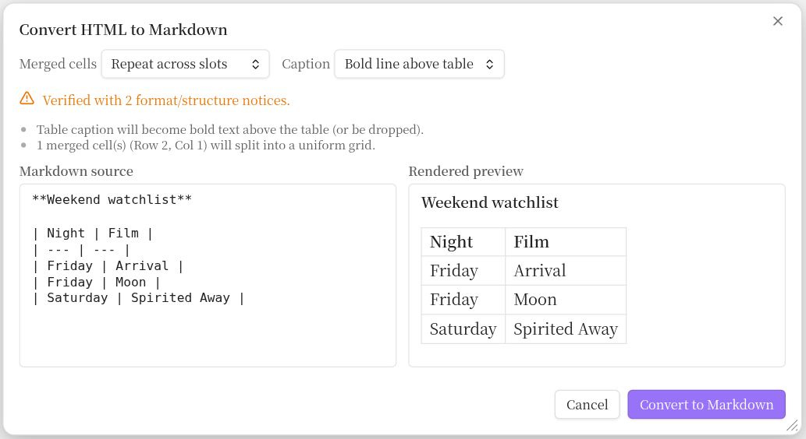
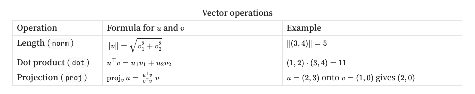

# HTML tables

Create tables with merged cells, grouped headers, and captions through a visual editor.


- **New table:** run **Patches: Insert HTML table**.
- **Existing HTML table:** hover it and choose **Edit table**, or run **Edit HTML table** with the cursor in its source.
- **Markdown to HTML:** place the cursor inside a Markdown table (or select complete tables), then run **Convert Markdown tables to HTML** from the command palette or editor context menu.

Try converting this table:

```markdown
| Day      | Plan                      | Area        |
| :------- | :------------------------ | :---------- |
| Saturday | Walk the canal and sketch | Higashiyama |
| Saturday | Tea break and bookshop    | Gion        |
| Sunday   | Morning market and lunch  | Downtown    |
| Sunday   | Riverside walk            | Kamogawa    |
```

Review the preview, drag across cells or Shift-click to select a range, then use **Merge cells**, **Split cell**, the row and column menus, or alignment controls. Edit the caption above the table. Choose **Convert to HTML** to apply the result; **Cancel** leaves the note unchanged.

Select several complete Markdown tables to convert them together. **Previous table** and **Next table** switch between drafts, and **Convert all N tables** writes the batch in one undo step. Conversion preserves headers, alignment, common inline formatting, and links. Tables in code blocks, lists, or callouts are excluded. Images, embeds, footnotes, and excess cells are rejected before anything is written.

## Convert an HTML table to Markdown

In the next release, place the cursor inside a standalone HTML table and run **Patches: Convert HTML tables to Markdown**. You can also select several complete tables, or choose **Convert to Markdown** in the visual table editor. Compare the Markdown source with its rendered preview. For merged cells, headers, and captions, choose how to represent them and review any formatting that Markdown will drop. Patches checks the result with Obsidian’s renderer before applying the conversion in one undo step.

On desktop, drag the bottom-right corner of the conversion preview to give a wide table more room. The preview remembers its own size in this vault, separately from the table and callout editors. Double-click the corner to restore the default. In a narrow preview, the rendered table moves below the Markdown source.

When converting from Reading View, keep the note open until you confirm. Patches switches that tab to editing so you can undo the conversion there. If another pane changes the note, reopen the conversion to check it against the latest text.

In this watchlist, one Friday cell spans two films. Choose **Repeat across slots** to keep the night beside both titles. **Bold line above table** keeps the caption above the Markdown table.



<details>
<summary>Try the watchlist in a note</summary>

```html
<table>
<caption>Weekend watchlist</caption>
<thead><tr><th>Night</th><th>Film</th></tr></thead>
<tbody>
<tr><td rowspan="2">Friday</td><td>Arrival</td></tr>
<tr><td>Moon</td></tr>
<tr><td>Saturday</td><td>Spirited Away</td></tr>
</tbody>
</table>
```

</details>

## Convert tables with inline formulas

Patches 0.5.1 preserves `$...$` in table headers and body cells. The table editor shows editable TeX. Obsidian typesets it in Reading View, and Patches enables the same rendering in Live Preview.



Paste this table into an Obsidian note, run **Convert Markdown tables to HTML**, and enter “Vector operations” in the caption field to match the screenshot.

```markdown
| Operation | Formula for $u$ and $v$ | Example |
| :--- | :--- | :--- |
| **Length** (`norm`) | $\lVert v\rVert = \sqrt{v_1^2 + v_2^2}$ | $\lVert (3,4)\rVert = 5$ |
| **Dot product** (`dot`) | $u^\top v = u_1v_1 + u_2v_2$ | $(1,2) \cdot (3,4) = 11$ |
| **Projection** (`proj`) | $\operatorname{proj}_v u = \frac{u^\top v}{v^\top v}\,v$ | $u=(2,3)$ onto $v=(1,0)$ gives $(2,0)$ |
```

## Edit an HTML table

In the editor, Tab moves between cells, Enter adds a line within a cell, and Escape leaves the cell. Pasting inserts plain text with its line breaks; Mod+Z and Mod+Shift+Z undo and redo edits. **Save** or Mod+Enter applies HTML-table edits. Saving preserves untouched cell markup and checks for conflicting source changes. Tables inside callouts and blockquotes are excluded from editing.

On desktop, drag the bottom-right corner of the table editor to resize the grid. The editor remembers this size in the current vault. Double-click the corner to reset.

In the next release, a conflicting edit keeps the draft open. Editing and conversion support up to 50,000 grid positions per table. Count rows times columns after expanding merged cells, including empty positions. If a table exceeds the limit, split it into smaller tables before opening it in the visual editor.

## Inline code font

In the next release, open **Settings → Patches → HTML Tables → Inline code font** and enter an installed family name such as `JetBrains Mono`. Press Enter or leave the field to apply it to inline code in standalone HTML table cells in Reading View, Live Preview and the visual editor. Clear the field to use the theme font again. The font preference is saved in this vault. The font must be installed on each device.

## Related reference

[Table commands](../reference/commands.md) · [Troubleshooting table conversion](../troubleshooting.md#table-conversion-is-unavailable)
