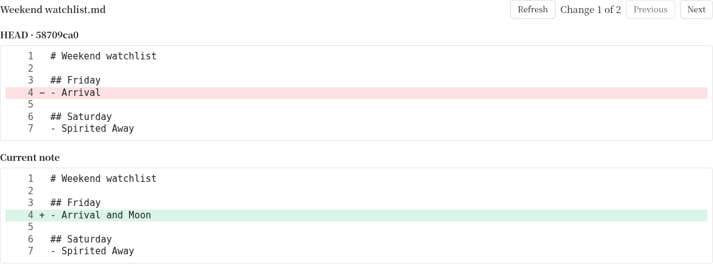
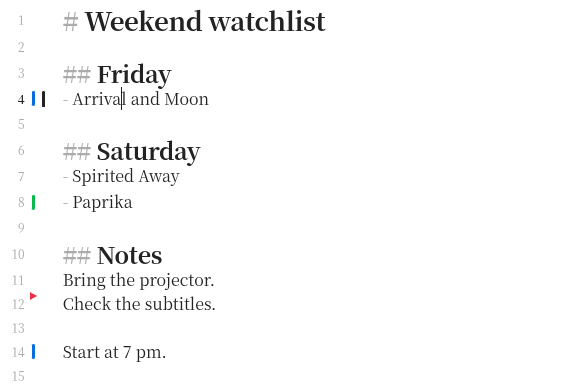

# Commands

Open Obsidian’s command palette and search for **Patches:**. Context-sensitive commands appear when the current note or cursor position supports them.

| Command | When to use it |
| --- | --- |
| **Insert HTML table** | Create a table with the visual editor. |
| **Edit HTML table** | Edit the HTML table at the cursor. |
| **Convert Markdown tables to HTML** | Convert the table at the cursor or a selection of complete tables. |
| **Convert HTML tables to Markdown** (0.6.0) | Preview the Markdown for one or more complete HTML tables, choose how to handle merged cells or captions, and apply the change in one undo step. |
| **Insert callout** | Insert a callout or wrap selected lines. |
| **Edit callout** | Edit the callout at the cursor. |
| **Convert callout to text** | Remove its callout/blockquote wrapper. |
| **Convert callout to blockquote** | Keep a plain blockquote without a callout header. |
| **Check diagrams in this note** (0.5.0) | Check `patch-mermaid` syntax and jump to each affected block in the editor. |
| **Check callouts for GitHub** | See how GitHub displays each callout in the current note, inspect its reasons, and jump to its line. |
| **View Git diff for this note** (0.7.0, desktop) | Open the current note’s local Git comparison. |
| **Toggle Git change markers for this vault** (0.7.0, desktop) | Show or hide added, modified and deleted lines beside the editor. |
| **Format math block** | Format the display-math block at the cursor. |
| **Format all math blocks in note** | Format supported display-math blocks in the current note. |
| **Select cover** | Choose media from the vault for the current note. |
| **Remove cover** | Remove the note’s cover property, keeping the media file. |

## Compare a note with Git

In 0.7.0, the vault root must be in a local Git working tree. A repository in just one of its subfolders does not enable these commands. Patches checks again when the app regains focus. Open a Markdown note and run **Patches: View Git diff for this note**. The command opens a read-only tab. The upper pane shows the note at the repository’s current commit (`HEAD`). The lower pane includes edits from the open editor, including unsaved text. In Reading View it uses the saved note when there is no open editor for that file.

Red lines marked **−** were removed. Green lines marked **+** were added. **Previous** and **Next** move both panes to the same change, with surrounding lines for context. Leave the diff tab open alongside the editor to follow edits. Patches reads `HEAD` again when you return to the note or its window. Use **Refresh** to check immediately after a commit or branch change. Reopening the command for the same note reuses its tab. A note with no entry at that path in `HEAD` appears as added, including a newly renamed note. Comparing notes requires a local Git executable on desktop.

Git vaults show markers by default in visible Markdown editors. Green marks added lines, blue marks modified lines, and a red triangle marks where lines were removed. Click a marker to open its change. The gutter works in Source mode and Live Preview, including with line numbers hidden. Run **Patches: Toggle Git change markers for this vault** to turn the gutter off or back on across the vault. This device remembers one switch. The manual comparison works with either setting.

## Other entry points

- **Icons:** right-click files or folders in the explorer, then choose **Change icon** or **Remove icon**.
- **Tables and callouts:** hover the rendered content to reveal its edit button.
- **Line width:** use plugin settings or the desktop status bar slider.
- **PDF navigation:** use Obsidian’s existing **Export to PDF** action.

Assign your preferred shortcuts in **Settings → Hotkeys** by searching for the command name.
